# Dreamed

*Un roguelite de supervivencia en pixel art sobre un niño que sueña dentro de un sueño dentro de un sueño.*
*A pixel-art survival roguelite about a boy dreaming inside a dream inside a dream.* — [English summary below](#english-summary)

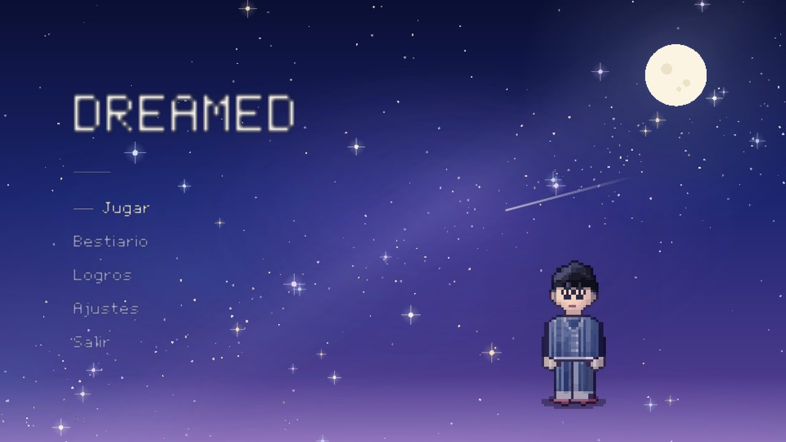

Kroker es un niño con gafas y pelo negro que se queda dormido... y cada oleada es un sueño dentro del anterior, cada vez más raro y abstracto. Se juega como **Brotato**: el arma ataca sola y tú solo te mueves y esquivas. Entre sueño y sueño mejoras al estilo de **Hades**: en el plano astral aparecen dos personajes (tres desde el nivel 3 de Kroker) y cada uno te ofrece un don distinto.

- **Motor:** Godot 4.7, probado en **Godot 4.7.2**.
- **Idiomas:** español e inglés, que se cambian en Ajustes.
- **Controles:** teclado, ratón y mando. Los textos de controles cambian solos según uses teclado o mando.
- **Arte y sonido:** todo hecho con código, desde los sprites y la fuente hasta la música y los efectos (ver [Herramientas](#herramientas)).

---

## Cómo jugar

1. Abre `project.godot` con Godot 4.7.2 y pulsa **F5**.
2. En el menú principal, pulsa **Jugar**: llegas al **plano astral**. Ve al armario, acércate a un pijama para ver su carta y pulsa **F** para ponértelo (cada uno trae un arma distinta). Luego ve a la fuente del centro y pulsa **F** para empezar a soñar.
3. Sobrevive a cada sueño hasta que se acabe el tiempo. Tu arma ataca sola.
4. Recoge los **trozos de estrella** que sueltan los enemigos para subir de nivel. Las mejoras de nivel se eligen al acabar el sueño, para no cortar la pelea.
5. Al acabar cada sueño, en el **plano astral**, elige uno de los dos dones que te ofrecen.
6. La partida se guarda al empezar cada sueño. Si sales, **Continuar** en el menú principal te devuelve al principio de ese sueño.

### Controles

| Acción | Teclado | Mando |
|---|---|---|
| Moverse (también por los menús) | WASD o flechas | Stick izquierdo o cruceta |
| Modo especial (almohada de Svinho) | E | Y |
| Aceptar / avanzar diálogos | Intro, Espacio o clic | A |
| Volver | Esc | B |
| Pausa (con resumen de estadísticas y mejoras) | Esc | Start |
| Ver más en una ficha que no cabe | Rueda del ratón | Stick derecho |

El mando vibra al recibir golpes; se puede desactivar en *Ajustes → Accesibilidad*.

---

## Los pijamas

Siempre es Kroker, pero vestido distinto, y cada pijama trae su arma. Se empieza con cuatro y los demás se desbloquean jugando. Están en el armario del plano astral: al acercarte a un soporte sale la carta de ese pijama, con su ficha de valoraciones y todas sus bonificaciones de serie (si no caben, la ficha se desplaza: con la rueda o, con mando, sola y con el stick derecho). Los bloqueados se ven en silueta, con cómo se consiguen.

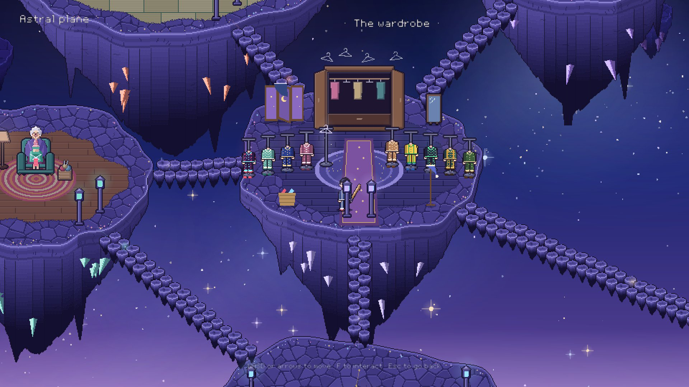

| Pijama | Arma | Cómo ataca | De serie | Cómo se desbloquea |
|---|---|---|---|---|
| **El Bateador** | Bate | Golpe cuerpo a cuerpo al enemigo más cercano | +20 % de daño y 3 de regeneración | Desde el principio |
| **El Guardián** | Escudo-almohada | Poco daño, pero empuja mucho en cono | +4 de defensa, +5 de vida máxima, 2 de regeneración y algo más lento | Desde el principio |
| **El Cuentacuentos** | Libro | Hace caer de 1 a 3 rayos del cielo; cada uno golpea a un enemigo | −2 de vida máxima, −10 de suerte y 6 % de robo de salud | Desde el principio |
| **El Barrepesadillas** | Aspiradora | Atrae al enemigo al que apunta mientras lo daña. Si está a media vida o menos y lo arrastras por un agujero, se cae | +20 % de velocidad, +3 de vida máxima y 5 % de robo de salud | Desde el principio |
| **El Pistolero** | Pistola de dedos | Rayos láser con un efecto al azar: normal, atraviesa, empuja, crítico x1,75, rebota... o sale hacia atrás. La suerte hace más probables los buenos | +10 de suerte y 5 % de robo de salud | Llegar al Acto 2 |
| **El Abrazaosos** | Oso de peluche | Le arranca pelusa al osito y se la pega al enemigo: cada pelusa lo frena, los que se tocan se quedan pegados y una bola de 5 se aplasta | +6 de vida máxima y 3 de regeneración | Llegar al Acto 3 |
| **El Crack** | Pelota | La chuta al enemigo más cercano (poco alcance); rebota de uno a otro y vuelve. Mientras está en el aire no puede chutar otra | +15 % de daño, +20 % de velocidad, +4 de vida máxima, +6 de parry, −2 de defensa y −10 de suerte. Empieza con la mejora de Svinho a nivel 3 | Amistad 4 con Svinho |
| **El Ingeniero** | Portátil | Pone torretas que disparan solas y no desaparecen (ver abajo); las 2 primeras de cada sueño las monta deprisa | +5 de vida máxima, +5 de suerte y −15 % de velocidad de ataque | Amistad 4 con Silly |
| **El del 47** | Botas steampunk | Patadas propulsadas por los motores de las botas, en combo (ver abajo). Kroker las maneja con un mando pequeño en la mano | +10 % de velocidad, +1 de defensa y 2 de regeneración | Amistad 4 con Doc |

Cada pijama tiene un **post-it** con los actos que has superado con él (Actos I, II y III; estrella en normal, luna en pesadilla), al estilo de *The Binding of Isaac*. Superar un acto en pesadilla también marca el normal. Todo lo que tiene tiempo de recarga muestra un anillo de carga en la propia arma, como la stamina de *Zelda*.

### Las torretas del Portátil

- Como mucho hay **3 torretas de disparo** (más con Silly). Salen de tarde en tarde y, una vez puestas, se quedan; si una se queda muy lejos en el pasillo infinito, Kroker la recoloca.
- **Suben de nivel con el Ataque de Kroker**, también las que ya están puestas: nivel 2 con un 10 % (queman), 3 con un 25 % (empujan) y 4 con un 45 % (hacen sangrar). Cada nivel tiene un modelo más futurista; la de nivel 4 flota.
- Algunas mejoras traen **torretas especiales**, una de cada, que aparecen solas al empezar el sueño en sitios al azar y separadas (cerca de ellas no se pueden poner torretas de disparo):
  - **Doc:** torreta curativa que te dispara balas curativas si te falta vida.
  - **Stolk:** muñeco de boxeo que atrae a los enemigos cercanos y les da puñetazos con mucho empuje.
  - **Mr. Ad:** torreta dorada que apunta al enemigo con menos vida y remata a los que tienen menos del 15 %; cada remate da Realidad Fragmentada.
  - **El Pinche:** fogón que atrae enemigos y, si se juntan muchos a su lado, explota; al rato vuelve a aparecer.

### Las botas steampunk

- **Combo de tres golpes:** patada con la derecha, patada con la izquierda y un **giro** de 360° con la pierna estirada: es cuerpo a cuerpo como las patadas, hace poco daño pero **empuja mucho** a los que tiene al lado y **devuelve los proyectiles** que le llegan (vuelven dorados y dañan a los enemigos). Si pasa un rato sin atacar, el combo vuelve a empezar.
- **Dash:** pulsa **espacio** (R1 / RB en el mando). Kroker sale disparado hacia donde se mueve (o hacia donde mira si está quieto) con los motores a tope, no le pueden dar mientras dura ni un momento después (parpadea) y, si arrolla a un enemigo, le hace mucho daño y lo empuja lejos (sirve para tirarlos por los agujeros). Tiene su propio anillo de recarga.
- **Mejoras:** Svinho (Chilena: el pateado sale volando contra otros), Stolk (+daño), Silly (el dash se recarga antes y congela), Doc (vida máxima a cambio de patadas más lentas), Mr. Ad (+velocidad por cada 10 de Realidad Fragmentada) y el Pinche (las patadas queman).

---

## Los sueños

### Acto 1: la habitación (sueños 1–5)

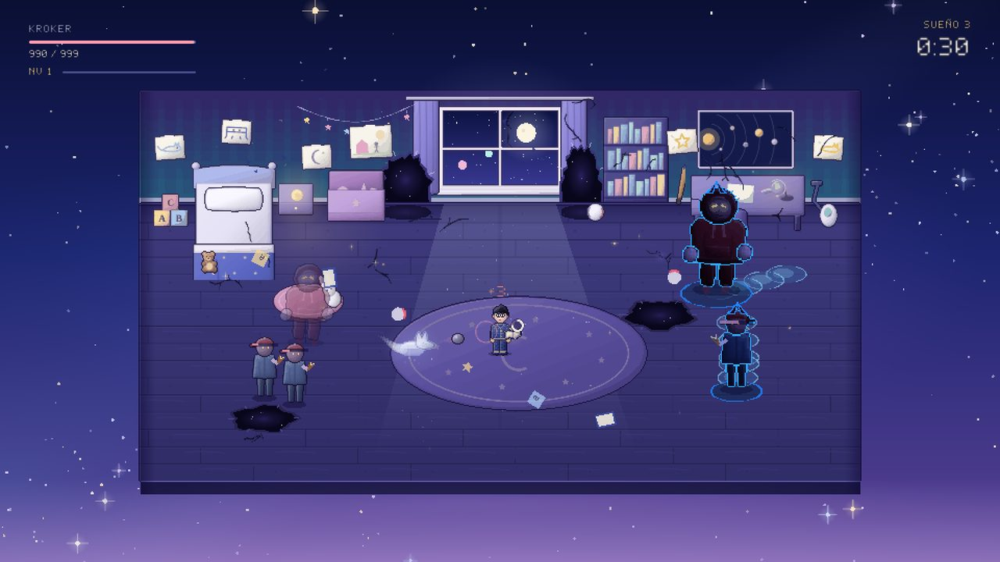

Kroker se despierta, se pone las gafas y va a por su arma: el bate en la pared, la almohada y el osito de la cama, el libro del escritorio, la aspiradora de la esquina y, cuando ya son suyas, las botas steampunk bajo la ventana, el portátil abierto encima del escritorio y el balón en el haz de luna. La pistola de dedos no hay que buscarla: la levanta junto a la cara, hace girar el dedo como un revólver, hace clic y sopla el humo. En cada sueño la habitación se corrompe un poco más: salen grietas, trozos de pared flotando y **agujeros** en el suelo y en la pared. Si empujas un enemigo a un agujero, cae y muere aunque le quede vida.

Arriba en el centro hay un **cronómetro con el tiempo total de la partida**; solo cuenta mientras juegas (no en las mejoras, la tienda ni la pausa).

| Sueño | Enemigo nuevo |
|---|---|
| 1 | **Foox**: zorro fantasma, lento y frágil |
| 2 | **Matón**: enorme, mucha vida y golpes fuertes |
| 3 | **Tirachinas**: marca la trayectoria antes de disparar |
| 4 | **Esqueleto**: se desmonta y, si no rompes sus huesos, se vuelve a levantar |
| 5 | **Jefe: la habitación despierta**. Primero la cama, que salta y provoca un sismo; luego la estantería, que lanza libros; y por último el baúl, que huye y suelta enemigos |

### Acto 2: el salón (sueños 6–10)

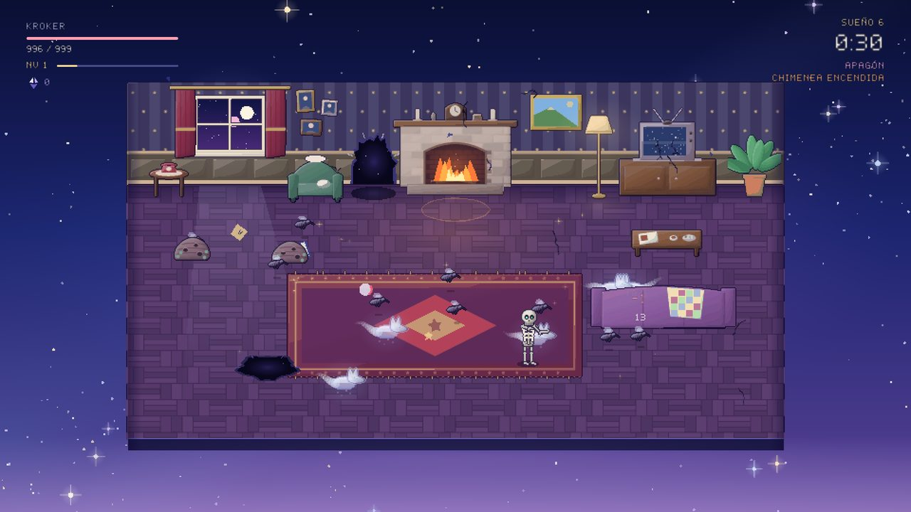

Tras vencer al jefe, el sueño se hunde un poco más y Kroker cae en el salón de casa: chimenea de piedra, sillón de la abuela, una tele antigua con nieve y un sofá que tapa a quien pasa por detrás. Como la habitación del Acto 1, el salón se ve con un poco de zoom para que ocupe casi toda la pantalla.

| Sueño | Novedad |
|---|---|
| 6 | **Nidos y mosquitos**: el nido no se mueve, pero suelta mosquitos mientras no lo rompas. Los mosquitos son diminutos y frágiles, pero muy rápidos y salen a montones |
| 7 | **Chapuzas**: un topo ingeniero steampunk (gafas de latón, delantal de cuero, llave inglesa y mochila de vapor) que corre al agujero más cercano, lo tapa con tablones y monta encima una **torreta de vapor** que te dispara pernos con aviso. Mientras la torreta aguante, por ese agujero no cae nadie; al romperla, los tablones se hunden. Él no pega, huye y a los 7 s va a montar otra (máx. 2 suyas y 3 en total). No se le puede tirar por los agujeros: hay que matarlo a golpes. Como mucho 2 a la vez; desde el sueño 8 sale de vez en cuando en todos los actos |
| 8 | **Cyberpunk** (raro, como mucho 2 a la vez): se lanza a base de dashes que marca antes en el suelo y, si se te queda cerca, te **hackea**: te baja una estadística al azar hasta que lo derrotas |
| 10 | **Jefe: El Chef**, un Kroker adulto cocinero que sale de la tele |

**El Chef** tiene tres ataques, todos avisados antes:

- **Cuchillos** en abanico: si te da uno, sangras durante un rato.
- **Sartenazo** de cerca: si te da, te quedas clavado medio segundo.
- **Platos** lanzados en arco a puntos marcados: al romperse dejan trozos en el suelo que hacen daño al pisarlos.

Con menos de la mitad de vida se enfada: ataca más a menudo y lanza más cosas.

El resto del salón:

- **Kioskera Charo** (*Karen* en inglés): la primera vez que llegas, te da la bienvenida y te explica dónde estás. De vez en cuando abre su kiosco para venderte cosas a cambio de **Realidad Fragmentada**. Una vez la conoces, también aparece tras el sueño 3 del Acto 1.
- **Realidad Fragmentada:** la moneda de Charo. Sale de lo que más guerra da y de lo que se cae y no vuelve... Una vez conoces a Charo, también se gana en el Acto 1 de las partidas siguientes. Tirar enemigos por los agujeros solo la da a veces (casi nunca durante un jefe).
- **El kiosco** tiene 33 artículos y mejora con cada acto: en el Acto 1 vende cosas flojas y baratas (4–6 ◆); desde el Acto 2 todo es bastante más caro: en el 2 cosas medias (10–17 ◆), en el 3 cosas buenas (23–36 ◆), como la tarta de cumpleaños (+5 de vida máxima), el pack de pilas (dos niveles) o el periódico del domingo (dos mejoras suben de nivel), y en el 4, la Metrópolis (sueños 17 y 19), lo mejor y lo más caro (35–54 ◆): bebida energética, gato de la suerte, botiquín, cómic de SuperK y enciclopedia. Cambiar el mostrador cuesta 1 ◆ en el Acto 1, 3 en el 2, 5 en el 3 y 7 en el 4 (y 1 más cada vez). Se puede pagar por **cambiar el mostrador**; los artículos ya comprados se quedan.
- **Cachivaches** (`trinkets.gd`): 12 artículos que no suben estadísticas, sino que hacen algo propio; si compras varios del mismo, el efecto se acumula, aunque cada copia extra suma menos (el patito y el despertador solo se compran una vez).
  - Acto 1: **patito de goma** (para el primer golpe de cada sueño; solo se compra uno), **petardos** (cuando te dan, estallan: 3 de daño y empujan lejos), **hucha de cerdito** (9 ◆; al acabar cada sueño, 1 ◆ por cada 8 ahorrados, hasta 4 en total; con dos huchas, por cada 6; con tres, por cada 5).
  - Acto 2: **globos de agua** (cada 5 s cae uno sobre el enemigo más cercano: 4 de daño y ralentiza), **silbato de árbitro** (cada enemigo que cae por un agujero te cura 2), **muñeco vudú** (quien te hace daño recibe el triple; los jefes, solo el mismo daño), **imán de nevera** (los trozos de estrella vienen desde el doble de lejos).
  - Acto 3: **caja de cerillas** (20 % de que quien derrotas queme a los de al lado, salvo si ya ardía: así no hay cadenas), **despertador** (con poca vida suena y congela 2,5 s a los de alrededor, una vez por sueño; solo se compra uno), **piñata** (los élites siempre sueltan un objeto y 2 ◆ más).
  - Acto 4: **bola de nieve** (al subir de nivel congela 2 s toda la pantalla) y **caja de música** (cada 14 s, una nana duerme 3 s a los de alrededor y reciben un 50 % más de daño).
- **En la pausa** se ve lo que has comprado en el kiosco, con cuántos de cada (por ejemplo, *Pila del despertador x2*).
- **La chimenea:** en algunos sueños está encendida. Ponte delante y pulsa la **F** (A en el mando) para echar una de tus mejoras al fuego: pierde un nivel, pero ganas Realidad Fragmentada, más cuanto más nivel tenga (16, 24 o 32; 40 si es legendaria).

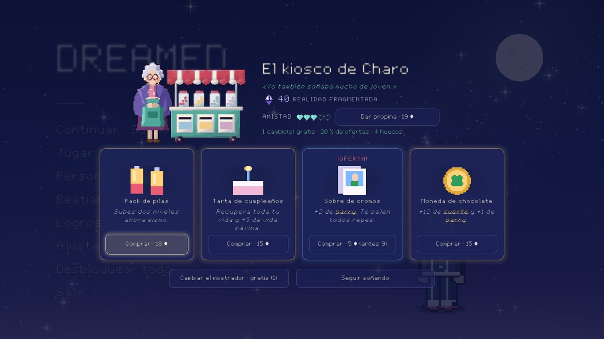

### Segunda arma

Al vencer a El Chef eliges una **segunda arma**, siempre del otro tipo: si tu pijama lleva un arma cuerpo a cuerpo (bate, almohada, oso o botas), eliges una a distancia (libro, aspiradora, pistola de dedos, pelota o portátil), y al revés. Solo salen las que ya tengas desbloqueadas. Kroker lleva la segunda arma en la mano libre, ataca sola y tiene **sus propias mejoras**. En el plano astral, cada don tiene una pestaña por arma para decidir a cuál va.

### Acto 3: el pasillo del colegio (sueños 11–15)

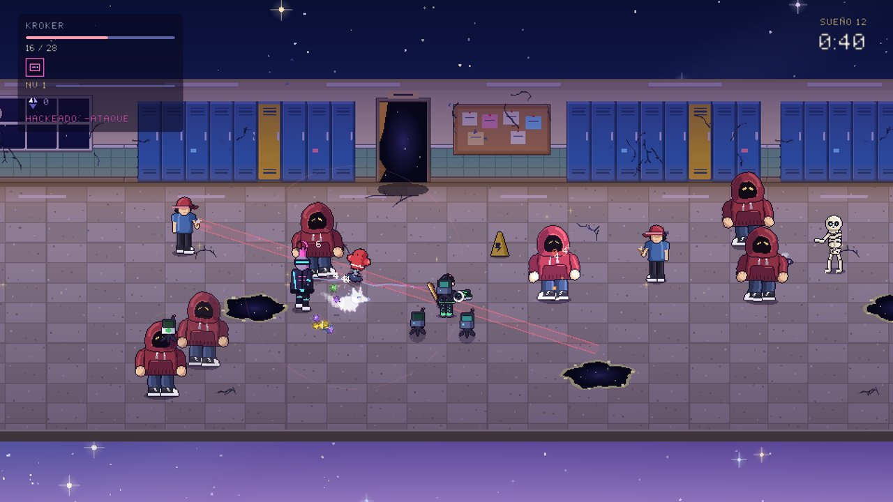

Un pasillo **infinito** hacia los lados, al estilo de la biblioteca de *Vampire Survivors*: la cámara sigue a Kroker entre taquillas, puertas de clase, baños, fuentes y vitrinas, todo con luz de anochecer. Las puertas se rompen y sirven de boquete para tirar enemigos.

| Sueño | Novedad |
|---|---|
| 11 | **Marionetas**: cada una sale con un brazo distinto: cuchilla (te hace sangrar), barra eléctrica (te paraliza) o arcabuz (bala potente, la marioneta sale despedida hacia atrás) |
| 13 | **Gólem de papel higiénico**: lento, con mucha vida y poca defensa. Si te pega, te deja **mal olor**: una de tus dos armas deja de atacar un rato |
| 14 | Kiosco de Charo |
| 15 | **Jefe: el Ovni** |

**El Ovni** pasa por el pasillo dando tumbos y lo destroza: quema las paredes, dispara láseres, abre agujeros en el suelo con su rayo y deja caer enemigos. Mientras vuela no se le puede dar; cada cierto tiempo se estrella justo donde está Kroker (con aviso en el suelo) y ahí sí, pero en el suelo suelta anillos de láseres con un hueco para esquivar. A media vida se enfada: más láseres, dos rayos a la vez y más enemigos. Al vencerlo (o aguantarlo) se acaba el Acto 3 y el sueño sigue en la Metrópolis.

### Acto 4 (el final): la Metrópolis (sueños 16–20)

Una **ciudad grande y abierta** que se recorre en todas direcciones, al estilo de las ciudades centrales de los juegos de Pokémon: avenidas en cruz, una gran plaza con fuente, la torre de los sueños al norte, tiendas, casas y bloques de pisos, un parque con estanque, un jardín con parterres al sur y un bosque alrededor (plano de 44 × 30 baldosas, `tools/make_city_map.py`). La cámara sigue a Kroker en las dos direcciones y, si pasa por detrás de un edificio, el edificio se vuelve transparente. Los enemigos rodean los edificios para llegar hasta ti.

Cada sueño la ciudad tiene una **estética distinta**, sin repetir en la partida: **synthwave** (neón rosa y cian, palmeras de neón), **steampunk** (ladrillo, latón, engranajes y adoquines), **de queso** (todo de queso con agujeros), **Frutiger Aero** (cristal brillante, burbujas y verde), **solarpunk** (edificios blancos con plantas y placas solares), **dieselpunk** (art déco oscuro y dorado) o **brutalista** (hormigón gris). Arriba a la derecha sale cuál toca.

Todo está cuidado al detalle, en pixel art visto desde arriba: las casas tienen **tejado a dos aguas** con tejas, cumbrera y chimenea; los bloques y tiendas, **azoteas con pretil**, gravilla y cosas encima (aires acondicionados con el ventilador girando, depósitos de agua, casetas, placas solares, claraboyas, un **helipuerto** en los bloques grandes) y además el detalle de cada estética (vallas de neón, chimeneas con humo, agujeros de queso, cúpulas de cristal, huertos, bloques de hormigón...). Las fachadas llevan cornisa, zócalo, escalón y felpudo; las tiendas, cartel luminoso; la torre, una antena con baliza y un cartel de estrellas. Delante de los edificios hay jardineras, papeleras y máquinas expendedoras. La plaza tiene una **fuente redonda de dos platos** con chorros y ondas, el parque un **estanque** con orilla de piedras, nenúfares y juncos, y el suelo grietas, charcos, hojas y sumideros. Por encima, cada ciudad tiene su **ambiente**: cuadraditos de neón, humo y chispas, migas de queso, burbujas, pétalos, ascuas o lluvia.

**Calles y estilo propio de cada ciudad.** Los brazos de las avenidas son **calzadas de verdad**: bordillo, doble línea en medio, carriles, pasos de cebra y **coches aparcados** (con la forma de cada ciudad, y estorban). La steampunk tiene adoquines y **raíles de tranvía**; la solarpunk, una **mediana con césped** y carril bici; la synthwave y la frutiger aero, líneas que brillan; la noir, asfalto mojado con reflejos. Cada ciudad construye a su manera:
- **Synthwave:** tubos de neón que laten en cornisas, esquinas y cumbreras, azoteas con rejilla de neón y casas convertidas en tiendas.
- **Steampunk:** tuberías de cobre con llaves por las fachadas, azoteas de chapa de cobre con pátina y buhardillas encendidas.
- **Queso:** queso fundido chorreando de los tejados y agujeros en las tejas.
- **Frutiger aero:** casas cápsula de tejado redondo, lucernarios de cristal y un brillo que recorre las fachadas.
- **Solarpunk:** cubiertas verdes con césped y caminito, hiedra colgando y placas solares en los tejados.
- **Dieselpunk:** buhardillas y focos que barren el cielo desde los bloques.
- **Brutalista:** sin tejados a dos aguas, solo bloques de hormigón con voladizos y manchas de lluvia.

Los bloques de pisos son más altos, los **rascacielos que se caen** tienen vestíbulo, cara lateral en sombra y un remate de cada ciudad (pirámide de neón, cúpula con reloj, cuña de queso, cúpula de cristal con hoja, jardín con molino, aguja art déco o bloques de hormigón), los árboles ya no salen en filas perfectas y, en las ciudades de noche, las farolas y los escaparates **iluminan el suelo**.

Cada ciudad tiene además sus **propias azoteas**: parabólicas y pirámides holográficas de neón (synthwave), calderas con manómetro y engranajes girando (steampunk), cuñas de queso y latas de galletas (queso), burbujas de cristal con plantas y molinillos blancos (Aero), huertos y aerogeneradores (solarpunk), focos que barren el cielo y torres de radio (dieselpunk) y bloques y tiros de ventilación con franjas amarillas (brutalista). La ciudad de queso tiene suelo de galleta salada y fachadas con chorreones de chocolate; la Aero, muros cortina de cristal azul con brillos; la brutalista, hormigón con marcas de encofrado, ventanas hundidas con plantas y señalética amarilla. La dieselpunk es art déco: pilastras con remate dorado, ventanas altas con luz cálida, abanicos dorados, estandartes rojos y zócalo de piedra crema; calles de acero remachado con óxido, plaza de terrazo con abanicos, azoteas con agujas escalonadas, depósitos remachados, focos que barren el cielo y un mástil de amarre de zepelines, y de vez en cuando cruza la ciudad la sombra de un zepelín.

- **Derrumbes:** por las calles hay rascacielos estrechos en pie desde el principio del sueño (10, o 16 en el último). Con el tiempo se van deshaciendo: se agrietan, se les revientan ventanas, se inclinan hacia donde caerán, sueltan cascotes y tiemblan cuando están a punto. De vez en cuando se cae uno de los que están cerca de Kroker (el más deshecho): primero se marca su sombra en el suelo; luego cae, hace mucho daño a lo que pille debajo (a ti también) y sus **escombros cortan el paso** casi medio minuto. Del rascacielos queda el muñón roto, que sigue estorbando.
- **Fuente y estanque:** su choque sigue su forma redonda (antes eran cuadrados y había muros invisibles en las esquinas).
- **Alcantarillas:** cada sueño hay más abiertas; sirven de agujero para tirar enemigos.

| Sueño | Novedad |
|---|---|
| 16 | **Unidad Especial**: una furgo blindada que vuela. Llega con la sirena, da vueltas alrededor de Kroker y suelta **policías** por una cuerda hasta que la derribas; al caer, revienta y daña a los de alrededor. Los policías tienen poca vida, disparan ráfagas de tres con su fusil de asalto y **cada bala hace sangrar**. Su uniforme cambia con la estética de la ciudad |
| 17 | **Antidisturbios**: salen de las alcantarillas abiertas. No te persiguen ni atacan: se quedan detrás y ponen **escudos** a los demás (dos cada vez, cinco como mucho). Un enemigo con escudo apenas recibe daño ni empujones, y el escudo solo desaparece cuando cae el antidisturbios que lo puso. Kiosco de Charo |
| 19 | Kiosco de Charo |
| 20 | **El último sueño**: noir retrofuturista y jefe final, **Evil Ad** (ver abajo). Si lo derrotas o aguantas, Kroker se despierta de verdad y se acaba la partida |

#### Sueño 20: noir retrofuturista y Evil Ad

El último sueño siempre tiene la misma estética: **noir retrofuturista**. Todo se ve en blanco y negro con mucho contraste, grano de película, rayas de proyector y viñeta; **solo el rojo conserva su color** (los rótulos de neón, la cinta del sombrero de Kroker... y Evil Ad). Rascacielos art déco con ojos de buey, ventanales con persianas venecianas y rótulos de neón rojos verticales, calles de asfalto mojado, plaza de terrazo a rombos, árboles pelados, farolas de globo, lluvia fuerte, relámpagos, focos que barren el cielo y la sombra de un zepelín. Kroker lleva un sombrero de detective.

- **Cinemática:** el sueño empieza con franjas de cine. Kroker, apoyado en la pared de un edificio, piensa en su viaje como un detective de cine negro, en recuadros de papel que salen letra a letra (la F pasa al siguiente, Esc lo salta). Al acabar, los edificios de alrededor **estallan** uno tras otro (se quedan ardiendo, con las ventanas reventadas y humo) y caen un par de rascacielos. La cámara se aleja hasta ver toda la ciudad, y las **vallas publicitarias** (la ciudad está llena: «BUY NOW», «OBEY», «DON'T WAKE UP», «SALE -99%», la sonrisa de Evil Ad...) y las **pantallas** de las fachadas se arrancan, suben al cielo y giran en un remolino cada vez más apretado hasta que se juntan y **forman a Evil Ad**. La cámara vuelve, Evil Ad se planta delante de Kroker y hablan (él en una pantalla roja, Kroker en papel): Evil Ad era la suscripción premium de Mr. Ad y todos los sueños estaban patrocinados por él. «Esta noche cancelo la suscripción.» «¡NO CAMBIES DE CANAL!», y empieza la pelea.
- **Evil Ad:** la versión retorcida y delirante de Mr. Ad. Una tele gigante rajada con ojos de «$» que giran y una sonrisa enorme, cuerpo de chapa roja oxidada con anuncios que pasan a toda velocidad por la barriga, cables que se mueven como tentáculos con megáfonos y teles pequeñas dando vueltas a su alrededor. Flota por encima de la ciudad (no le paran los edificios) y va cambiando de "programa":
  - **Teletienda:** se mueve alrededor de Kroker rociando abanicos de monedas rojas.
  - **Pop-ups:** suelta ventanas de anuncio («SALE!», «BUY!»...) que van a por Kroker y **estallan** a los 5 segundos si no las rompes antes.
  - **Zapping:** carga los ojos (con aviso) y barre la calle con un rayo de interferencias.
  - **Corte publicitario:** «Volvemos después de la publicidad...»: se mete en la estática (no se le puede dar), aparece un aviso en el suelo donde está Kroker y cae encima con una onda y un anillo de monedas.
  - **Patrocinado:** llama a policías y otros enemigos de la ciudad.
  - **Un mensaje de nuestros patrocinadores:** te llena la pantalla de pop-ups chillones que parpadean y se mueven («¡HAS GANADO!», «¿SEGURO QUE QUIERES DESPERTAR?»...) y no dejan ver. Cada uno se cierra con un **QTE**: la tecla **1-4** o uno de los **cuatro botones de la cara del mando** (el dibujo enseña cuál se enciende, con las letras de Xbox o Nintendo o las formas de PlayStation, según el mando). Con ratón también se cierran pulsando su X. Si pulsas el que no es, tiemblan todos. Los que sigan abiertos a los 9 segundos estallan y hacen un poco de daño. Mientras tanto, él sigue tirando monedas despacio.
  - **Delirio** (a media vida): «¡¡SUPER-MEGA-OFERTAAA!!». Más rápido, espirales de monedas, dos rayos a la vez, el doble de pop-ups, más teles a su alrededor y la imagen entera se descuadra a ratos (interferencias de color).
- Tiene tiempo límite, como los otros jefes: si aguantas, también despiertas. Derrotarlo da el logro **Fin de la emisión**. Su estatua aparece en el museo del plano astral.
- Música propia: jazz lento de madrugada para la cinemática y un jingle de anuncio retorcido para la pelea.

### Jefes con tiempo límite

Los jefes tienen cuenta atrás: 2:30 los muebles del Acto 1, 2:00 El Chef y 2:30 el Ovni. Si aguantas hasta el final, el jefe se retira y pasas igualmente. Si lo derrotas antes, te llevas **un nivel de regalo**.

- **La habitación despierta:** los muebles van uno detrás de otro y se mueven todo el rato. El baúl huye a ratos y luego se para, cansado y sudando: es el momento de pegarle.
- Todos los jefes son un 25 % más duros (atacan más a menudo y pegan más) en las dos dificultades.

### Eventos

Desde el sueño 2, más de la mitad de los sueños (55 %) traen un evento al azar, nunca el mismo que en el sueño anterior:

- **Apagón:** solo ves alrededor de Kroker y, si la chimenea está encendida, alrededor del fuego.
- **Suelo inclinado:** todo resbala hacia un lado y luego hacia otro.
- **Lluvia de estrellas:** caen estrellas del cielo sin parar. Antes de caer se marca en el suelo dónde van a dar; hacen daño a los enemigos de alrededor y a Kroker si no se aparta (algunas caen cerca de él).
- **Suelo helado:** una capa de escarcha; Kroker resbala y le cuesta arrancar, frenar y girar.
- **Fiebre de estrellas:** los enemigos salen más a menudo y van más rápido, pero cada uno suelta un trozo de estrella más.
- **Sonámbulos:** los enemigos van medio dormidos, muy lentos y con zetas en la cabeza, pero salen muchos más.
- **Bostezos:** el sueño bosteza y cada pocos segundos se abre un agujero pasajero junto a un enemigo, por el lado contrario a Kroker (como mucho 2 a la vez). Se abre como una boca, dura 5 s y se cierra solo; mientras está bien abierto, todo lo que empujes dentro cae.

**Timbre del colegio** (Acto 3, aparte del evento): suena en todos los sueños del pasillo, la primera vez a los 6-12 s y luego otra vez cada 14-22 s después de cada recreo. Mientras dura el recreo sale un montón de enemigos de las puertas: aparecen enseguida y salen corriendo hacia el pasillo en abanico durante un segundo, de lado y alejándose de Kroker, así que no se amontonan en la puerta ni se le echan encima.

Además, muy de vez en cuando aparece un **Foox dorado**: no hace daño y huye. Si lo pillas antes de que se esfume, te llueven estrellas.

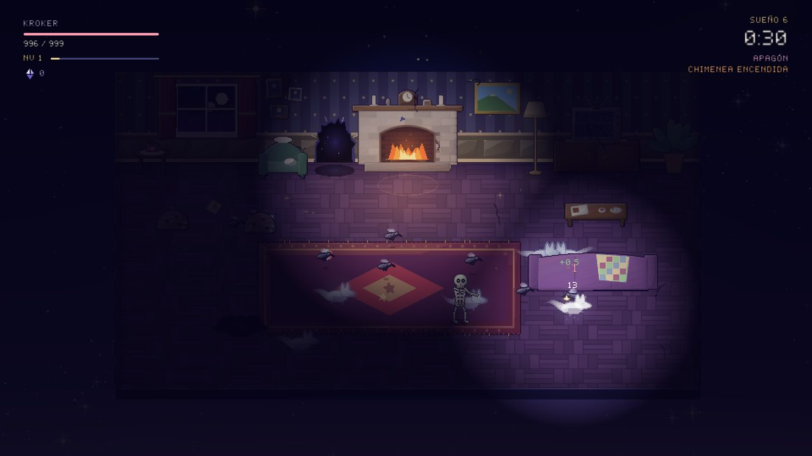

### Élites

Son enemigos demoníacos, con cuernos, un contorno que late, ascuas que suben y el triple de vida. El color del contorno dice qué hacen:

- **Naranja:** al morir se parten en dos Foox.
- **Azul:** dejan charcos que te frenan.
- **Morado:** van mucho más rápido.

---

## Cómo mejora Kroker

### Plano astral

Entre un sueño y otro aparecen dos de estos personajes (tres desde el nivel 3 de Kroker). Cada uno da un tipo de mejora que cambia según tu arma y que sube hasta el nivel 3. Al elegir, te quedas a solas con él y te habla. Las palabras que hay que explicar (sangrado, suerte, parry...) salen resaltadas: pasa el ratón por encima, o selecciónalas con el mando, y sale una tarjeta que las explica.

| Personaje | Quién es | Tipo de mejora |
|---|---|---|
| **Svinho** | Futbolista brasileño | Rebotes: golpes que encadenan enemigos y una almohada que se lanza |
| **Stolk** | El matón del colegio | Mucho más poder a cambio de vida máxima |
| **Silly** | Una hacker | Glitches: congelar, ralentizar o dejar vulnerables a los enemigos |
| **Doc** | Un doctor | Más vida máxima a cambio de empeorar otra estadística |
| **Mr. Ad** | Un humanoide cubierto de anuncios de chocolatinas y comida basura | Más Realidad Fragmentada y una estadística que sube cuanta más tengas ahorrada. Se desbloquea al llegar por primera vez al Acto 2 (con un logro) y desde entonces puede salir desde el principio |
| **El Pinche** | El aprendiz de El Chef, con gorro de papel, cuchillo y soplete | Sangrado (daño residual fuerte) o quemadura (daño residual flojo, pero el enemigo hace menos daño y recibe más), según el arma. Se desbloquea al llegar por primera vez al Acto 3 |
| **Magnus** | Un magnate de los negocios detrás de su escritorio | **Inversiones**: le pagas Realidad Fragmentada y te sube varias estadísticas al momento, con un objetivo para el siguiente sueño (derrotar enemigos, tirarlos por agujeros, derrotar élites o no recibir muchos golpes). Si lo cumples, te las quedas y te devuelve más dinero; si no, te las quita y se queda el dinero. Se desbloquea al superar el Acto 3 |
| **SuperK** | El superhéroe de los cómics de Kroker (traje morado, capa naranja, antifaz y una K dorada) | **Te ayuda en persona**: según el arma, baja volando y le da un puñetazo enorme al enemigo más fuerte (bate, botas), aparece y para un golpe que te iban a dar (almohada, oso), cruza la pantalla barriendo una fila con los láseres de los ojos (libro, pistola, portátil) o agarra a un enemigo y lo tira por el agujero más cercano, o lo estampa contra los demás (aspiradora, pelota). Se desbloquea al derrotar a la habitación despierta en pesadilla tumbando los tres muebles (aguantar hasta el final no vale) |
| **Lil Key** | Cantante de dembow de barrio, con chándal, cadenas, gorra del revés y gafas de sol | **Música**: con las armas cuerpo a cuerpo aparece a tu lado y los enemigos de alrededor se ponen a bailar sin hacer daño; con las de distancia se pone a cantar lejos de ti, los enemigos van hacia él y les hace daño poco a poco. Se desbloquea al encontrar sus gafas de sol en una taquilla abierta del colegio (sale de vez en cuando en el Acto 3): Kroker las lleva el resto de la partida y, desde entonces, se las vuelve a poner cada vez que Lil Key sale en un sueño |
| **D. Lynx** | Director de cine de pelo blanco hacia arriba, camisa abotonada hasta el cuello, café negro y megáfono; habla despacio y en clave | **Cine**: con el bate, las botas y la aspiradora, cada cierto tiempo aparece con su megáfono, grita «¡Acción!» y varios enemigos cercanos se ponen a actuar de tu parte un rato (pegan a los demás; las armas no les apuntan; los jefes, nidos, furgonetas y antidisturbios no aceptan papeles); con el escudo, el oso y la pelota te da una **toma 2** (una vez por partida, al caer vuelves con parte de la vida e invulnerable un momento); con el libro, el dedo y el portátil recorta el montaje y los sueños duran menos (los jefes no). Se desbloquea al llegar al sueño 20 |

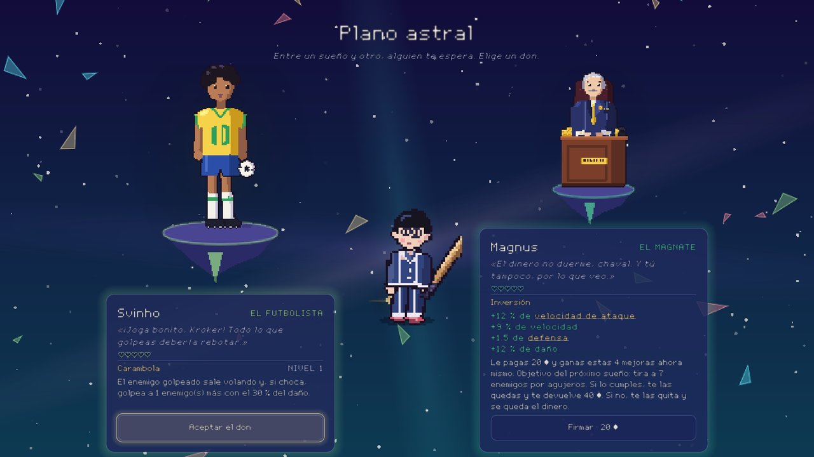

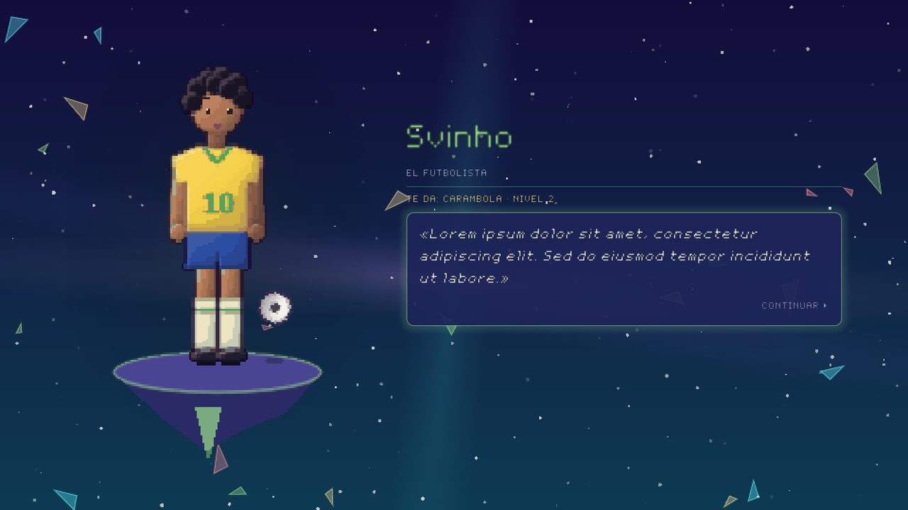

### Visitas entre personajes

Cuando un personaje llega a **amistad 3**, a veces deja su isla y va a ver a otro: al entrar en el plano astral suele haber una visita (con muchos amigos, a veces dos). El visitante se planta al lado del anfitrión, con bocadillos que se turnan encima de los dos, y su isla se queda vacía. Si te acercas, con la F (o A) **escuchas la charla**: cuatro frases que se van turnando, con la cara de quien habla en el recuadro. Hay nueve: Svinho visita a Stolk, Stolk a SuperK, Doc al Pinche, el Pinche a Charo, Charo a Doc, Magnus a Silly, SuperK a Lil Key, Lil Key a Svinho y D. Lynx a Mr. Ad.

### Mejoras dúo

Hay nueve mejoras dúo, una por arma; cada personaje sale en dos parejas distintas (salvo Mr. Ad y El Pinche, en una), y cada dúo va con un arma concreta. Solo cuenta el **arma principal** (la segunda, la que se consigue al final del Acto 2, no). Una mejora dúo se desbloquea para siempre al tener **amistad 3 con los dos** personajes, y sale en el plano astral (casi seguro, ocupando un hueco) cuando, en esa partida, las mejoras de los dos con esa arma están **al máximo** (nivel 3). Magnus no da mejoras de arma: para él cuenta haber ganado 2 tratos en la partida. En el menú de personajes se ve con quién hace dúo cada uno.

| Dúo | Arma | Mejora |
|---|---|---|
| Svinho y Silly | Botas | **Regate binario**: lo que lanzas con patadas y dash rebota en 1 enemigo más; todo lo que toca el rebote se congela 1 s y recibe +50 % de daño un rato |
| Stolk y Doc | Bate | **Receta de matón**: las mejoras de Stolk no cuestan vida máxima, la de Doc no baja el daño y cada enemigo que tumbas con el bate te cura 1 |
| SuperK y Lil Key | Escudo | **Concierto benéfico**: SuperK para golpes con +10 % de probabilidad y, cada vez que para uno, Lil Key pone a bailar a los de alrededor 4 s |
| Mr. Ad y D. Lynx | Portátil | **Pausa publicitaria**: cada 20 s, D. Lynx rueda un anuncio de Mr. Ad en una tele gigante; los enemigos a la vista se paran a mirarlo 3 s y reciben +50 % de daño, y ganas 1 de Realidad Fragmentada por cada 4 que miran (hasta 5) |
| El Pinche y Magnus | Libro | **Franquicia**: los enemigos que mueren quemados tienen un 30 % de soltar 1 de Realidad Fragmentada y pasan el fuego a los 2 de al lado |
| Svinho y SuperK | Pelota | **Chilena de héroe**: cada 6 toques de la pelota, SuperK baja volando y remata de chilena al enemigo más fuerte (40 de daño) |
| Silly y D. Lynx | Aspiradora | **Doble digital**: lo que aspiras 1,5 s seguidos sale escaneado como un doble que actúa para ti 6 s (hasta 3 a la vez; los jefes no) |
| Stolk y Magnus | Dedo | **Cobro con intereses**: críticos mucho más frecuentes y con +50 % de daño; cada crítico tiene un 15 % de cobrar 1 de Realidad Fragmentada |
| Doc y Lil Key | Oso de peluche | **Musicoterapia**: cuando Lil Key pone a bailar, cada enemigo que baila te cura 0,3 por segundo (hasta 1,5) y se le pega pelusa |

### Mejoras legendarias

Si un personaje **no tiene mejora dúo con tu arma** (o es la segunda arma, que nunca tiene dúo), con **amistad 5** puede ofrecerte un **nivel 4 legendario** de su mejora cuando ya la tienes al 3. Los números siguen la subida de los niveles anteriores, una vez y media más grande: lo que se cuenta (rebotes, enemigos...) sube al menos 1, las recargas bajan como mucho un 30 % y las pegas de Doc no empeoran.

### Combos

Hay mejoras que se ayudan entre sí, y el juego te lo enseña: en la tarjeta del plano astral aparece «Completa un combo» si al cogerla se forma uno, al completarlo sale un aviso, y en la pausa y en el diario se listan los que tienes. No dan nada extra; es que juntas funcionan mejor. Son: Equilibrio clínico (Doc + Stolk), Capital riesgo (Mr. Ad + Magnus), Público en fila (canto de Lil Key + rebotes de Svinho a distancia), Todos en fila (canto de Lil Key + láser de SuperK), Bola de pelusa (Silly + Svinho en el oso), Succión crítica (Silly + Stolk en la aspiradora), Matón con doble (Stolk + Toma 2 de D. Lynx), Dedos de la suerte (dedo + 20 de suerte), Muro de almohada (escudo + 12 de parry), Directo al hoyo (lanzamiento de SuperK + Svinho) y Barbacoa del barrio (fogón del Pinche + canto de Lil Key).

**Estallido de píxeles** (Silly + Svinho, con cualquier arma) sí tiene efecto propio y se puede sacar en la primera partida: los enemigos glitcheados por Silly (o pegados por la pelusa del oso, o con el eco del libro) estallan al morir y los píxeles rebotan contra los de alrededor, haciéndoles 6 de daño y glitcheándolos también, en cadena (como mucho unos pocos estallidos por segundo). Además, **mientras la partida no tenga ningún combo**, si un personaje del plano astral completaría uno, sale seguro entre los que te ofrecen, para que se descubran pronto.

### Amistad

La amistad con cada personaje se guarda entre partidas y llega hasta el nivel 5.
- **Primera vez:** la primera vez que coges un don de alguien, se presenta con una frase única y todavía no admite propina.
- **Propina:** desde la segunda vez, en la charla puedes darle propina con Realidad Fragmentada (10 ◆ para el nivel 1, 13 para el 2, 16, 19 y 22). Solo una por personaje y partida. Al dársela te da las gracias; lo nuevo que tenga que contarte lo dirá la próxima vez que lo veas.
- **Mejores dones:** cada nivel de amistad mejora sus dones un 6 % (hasta un 30 %); en los de Doc, lo que empeora pesa menos y las recargas bajan.
- **Conversaciones:** cada personaje te cuenta algo distinto en cada nivel de amistad.
- **Charo:** en el kiosco también se le puede dar propina, una por partida. Su amistad no baja precios: da cambios gratis del mostrador (1 desde amistad 1 y 2 desde amistad 4), ofertas a mitad de precio (desde amistad 2) y más huecos (4 con amistad 3 y 5 con amistad 5). También cambia lo que te dice al saludarte.
- **Magnus:** con más amistad, sus tratos devuelven más dinero.
- **Pijamas nuevos:** la amistad 4 con Svinho desbloquea la pelota; con Silly, el portátil, y con Doc, las botas steampunk.
- **Dónde verla:** la amistad sale con corazones en el menú Personajes, en las cartas del plano astral y en el kiosco.

### Niveles

Los enemigos sueltan **trozos de estrella**; cuanto más duro es el enemigo, más sueltan. Al subir de nivel sale un aviso («¡Nivel 3!») y el nivel del HUD marca cuántas mejoras tienes pendientes (+1, +2...). Al acabar el sueño eliges, por cada nivel, 1 de 3 mejoras de estadística, cada una con su rareza: común, poco común, rara, épica o legendaria. Con mando, izquierda y derecha pasan de carta en carta y desde *Cambiar* se vuelve a la del centro.

Las estadísticas son ataque, defensa, velocidad, velocidad de ataque, alcance, recuperación de salud, robo de salud, suerte y parry.

- **Defensa, recuperación y robo de salud rinden menos cuanto más tienes**, para que juntarlas no te haga inmortal:
  - La defensa resta daño a cada golpe, pero nunca más de la mitad; por encima de 6, cada punto vale la mitad.
  - La recuperación por encima de 1,5 rinde el 40 %, y el robo de salud por encima del 8 %, la mitad (y cura como mucho una vez por segundo).
  - Entre recuperación y robo de salud no se cura más de 0,5 de vida por segundo, con un pequeño colchón de 3. Los objetos, el batido y las curas de los personajes no cuentan para ese tope.
- La **suerte** hace más probables las rarezas altas, los consumibles y que vuelvan los personajes que ya te dieron un don. Puedes cambiar las tres opciones a cambio de 2 de suerte.
- El **parry** es una probabilidad de esquivar un golpe: Kroker chasquea los dedos y el que le iba a pegar, y hasta 3 enemigos de alrededor, caen fulminados (a los jefes solo les hace daño). Nunca pasa del 20 % (30 % con el Guardián). Se nota: el juego se congela un instante, suena un chasquido con brillo y un golpe grave, la pantalla da un fogonazo suave y tiembla, de Kroker sale una estrella de rayos con una onda que se abre y un rayo dorado va hasta cada enemigo que cae.

### Consumibles

A veces un enemigo suelta un objeto, y la suerte hace que pase más a menudo:

- **Vaso de leche:** cura.
- **Almohada:** para el siguiente golpe.
- **Despertador:** congela a todos los enemigos.

### Agujeros y golpe fuerte

Tirar enemigos por los agujeros los elimina aunque tengan vida (a los jefes no). Todas las armas pueden hacerlo:

- **Golpe fuerte:** cada pocos golpes, uno lanza al enemigo lejos y deja que caiga aunque llegue despacio; la masa cuenta menos, así que también vale con los matones. Unos puntitos bajo los pies de Kroker cuentan cuánto falta (dorados: el siguiente es fuerte). Bate, peluche, mando y botas: cada 3 golpes; libro: cada 4; pistola de dedos y portátil: cada 5. La almohada empuja ya de por sí y la aspiradora tira a los que tiene a media vida.
- **Tutorial integrado:** la primera vez que hay un agujero (Sueño 2), y si nunca has tirado a nadie, salen unos Foox entre Kroker y el agujero, y el agujero brilla con un anillo, una flecha y el cartel *¡Empújalos al agujero!* hasta la primera caída (o 25 s). Sin pausas ni ventanas.
- **Caídas en cadena:** si tiras a otro por un agujero antes de 3 s, la cadena sube y suelta tantos trozos de estrella extra como la cadena (hasta 5). Solo da experiencia, no daño.

### La vida y los estados

La vida no se rellena entre sueños: solo recuperas un 5 % de la vida máxima. Debajo de la vida, un indicador muestra los estados alterados que tienes en cada momento (sangrado, paralizado, mal olor, hackeado...). La hitbox de Kroker es solo el cuerpo: la cabeza no cuenta.

---

## Más

- **Menú principal:** se ve la versión del juego y hay un botón **Borrar partida** (hay que pulsarlo tres veces) que borra todo el progreso y la partida a medias; los ajustes se quedan. El icono del juego es la cara de Mr. Ad.
- **Créditos:** desde el menú principal, y solos la primera vez que despiertas del sueño 20. Suben despacio sobre el cielo del sueño con Kroker, el reparto (solo los personajes que ya conoces, con su medallón) y las pesadillas que has visto. Mantener cualquier tecla los acelera; Esc los cierra.
- **Golpes que se notan:** al tirar a alguien por un agujero, el juego se para un instante, la pantalla tiembla (más cuanto más pesa) y suena un glissando de kalimba que cae, con un «plof» lejano. Los enemigos grandes y los élite también paran un instante al morir. Como mucho una micro-pausa cada 0,4 s.
- **Sonidos propios:** el Gólem se deshace como papel, la Marioneta suelta maderitas, el Tirachinas pierde la goma, el Cyberpunk se apaga chisporroteando, la torreta del Chapuzas dispara vapor y su llave suena contra la madera.
- **Ritmo:** las frases que ya has leído (plano astral, Charo, el hub) salen casi de golpe. El diario cuenta cuánto tiempo has pasado peleando y cuánto entre pelea y pelea.
- **Música:** los cambios de canción son fundidos de potencia constante, sin bache, y la música de cada acto sigue por donde iba al volver del plano astral (las de jefe empiezan siempre por el principio).
- **Fiebre (pactos opcionales):** se desbloquea al superar el Acto 1, en la ventana de la fuente. Son 8 pactos que ponen el sueño más difícil y suben la temperatura de Kroker (36,6 °C + 0,4 por grado): *Multitud* (+30 % de enemigos, +2°), *Prisas* (enemigos un 18 % más rápidos, +1°), *Mala leche* (pegan un 30 % más, +2°), *Cristal* (-25 % de vida máxima, +1°), *Sequía* (la regeneración y el robo de salud curan la mitad, +2°), *Titanes* (jefes con +35 % de vida, +2°), *Kiosco cerrado* (+1°) y *Una sola mano* (sin segunda arma, +2°). Cada grado da un 8 % más de trozos de estrella y un 5 % de probabilidad de Realidad extra. Se recuerdan entre partidas y se guarda la fiebre más alta con la que superas un acto con cada pijama. Logros: superar un acto con 5° o más, y el Acto 4 con 8° o más.
- **Sueño del día:** también en la fuente. Cada día, la fecha decide el pijama, 2 o 3 pactos y la semilla de cada sueño (los mismos eventos y oleadas al repetirlo). Se guarda el mejor sueño alcanzado ese día; llegar al Sueño 10 da un logro.
- **Pantalla de resultados:** al acabar, junto al diario, el daño de cada arma en barras y los récords (sueño más hondo, enemigos, nivel y mejor caída en cadena), marcados con *¡Nuevo!* si los has batido; en el sueño del día y con fiebre, también lo dice.
- **Comentarios de la última partida:** la primera vez que hablas con cada personaje del plano astral después de una partida, te comenta qué tal fue: si la terminaste, si tiraste a muchos por los agujeros, si despertaste muy pronto o muy hondo, o quién te tumbó. Cada uno con su voz.
- **Dificultad Pesadilla:** se desbloquea al superar el Acto 1. Los enemigos tienen más vida y más daño, y salen más élites. En el jefe, los tres muebles atacan a la vez, aunque más despacio.
- **Plano astral (lobby):** es adonde lleva **Jugar** y adonde vuelves al acabar cada partida, al estilo de Hades. Es un archipiélago de islas flotantes de piedra astral unidas por puentes de piedras que flotan. En el centro está el cruce de los sueños, con una fuente de estrellas. Al principio está casi vacío: la isla de cada personaje aparece cuando Kroker lo conoce en el plano astral (desbloquearlo no basta). A su alrededor aparece una isla por cada personaje que Kroker ya conoce, con un trozo de su mundo encima (césped, gimnasio, cocina, despacho...) y él haciendo lo suyo: Svinho, de espaldas, chuta a portería en su medio campo (la red se hincha cuando entra el balón), Stolk levanta la barra por encima de la cabeza en el gimnasio, Silly rueda en su silla de un monitor a otro con los cascos puestos, Doc pasa la lupa por un pie gigante en su clínica podológica, Mr. Ad salta hiperactivo de una tele a otra del escaparate con la cara en primer plano, el Pinche (con el soplete tirado en el suelo, todavía encendido) corre de un fuego a otro de su cocina echándoles espuma con el extintor, Charo teje en su sillón, Magnus trabaja en su despacho, SuperK despega de su helipuerto en una azotea y da una vuelta a la isla, Lil Key da un concierto en su escenario con altavoces y focos, y D. Lynx espera en su plató, entre telones rojos sobre un suelo en zigzag, con la cámara, los focos y la claqueta, levantando el megáfono de vez en cuando. Las islas vecinas también están unidas entre sí por pasillos, así que no hace falta volver siempre al centro. Al acercarte puedes hablar con ellos con la **F** (o A en el mando): lore y lo que te cuentan según la amistad. El recuadro de diálogo va al estilo de Celeste: marco con adornos en las esquinas del color del que habla, el texto sale letra a letra con un clic suave (la F lo completa y luego cierra) y a la derecha aparece su cara de cerca en un marco cuadrado, sobre rayos de su color, moviendo la cabeza mientras habla. También tiene:
  - **la fuente de estrellas**, en el centro: con la **F** se abre la ventana de empezar a soñar (con la dificultad y el Modo Dios);
  - **el armario**, con un maniquí por pijama (los que aún no tienes, con el soporte vacío): al acercarte sale la carta del pijama y con la **F** te lo pones;
  - **el tatami**, detrás del armario, con un **muñeco de pruebas** para probar el arma, como el esqueleto de Hades: con la **F** entras a entrenar. No se rompe nunca, no hace daño, se tambalea con los golpes y enseña el daño por segundo. Los empujones lo arrastran por el tatami y, si lo sacas por el borde, cae al vacío; al segundo vuelve a su sitio. Con **Esc** → *Volver al plano astral* sales;
  - **el museo**, que sustituye al bestiario: una estatua por cada enemigo que has visto, con su ficha al mirarla, y pedestales vacíos para los que faltan.
- **Desbloquear todo:** botón del menú principal (hay que pulsarlo dos veces) que desbloquea logros, pijamas, personajes, bestiario y la dificultad pesadilla.
- **Museo:** las estatuas son de piedra tallada y cada ficha está escrita con la voz de Kroker.
- **Logros:** hay 35 (entre ellos, vencer a El Chef, comprar en el kiosco, sacrificar en la chimenea, ahorrar 100 de Realidad Fragmentada y desbloquear la pelota, el portátil, las botas, a Magnus, a SuperK, a Lil Key y a D. Lynx, conseguir una mejora dúo y una legendaria). Algunos pegan un dibujo infantil nuevo en la pared de la habitación.
- **Accesibilidad:**
  - intensidad de la sacudida de pantalla;
  - avisos para daltónicos;
  - números de daño;
  - vibración.
- **Al morir**, Kroker se despierta de golpe en su cama. **Al ganar**, duerme tranquilo y ves el resumen de la partida.

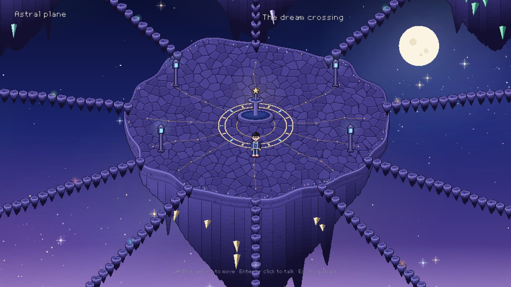

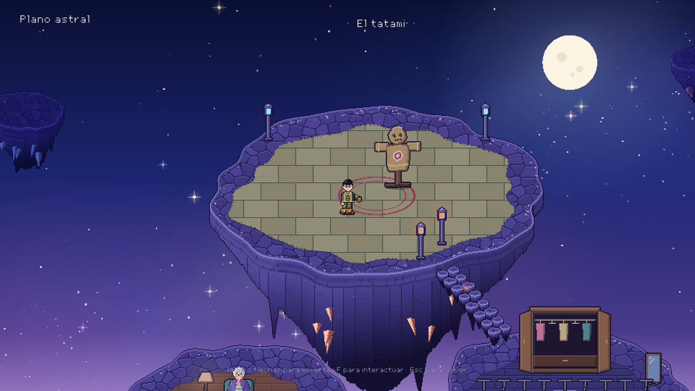

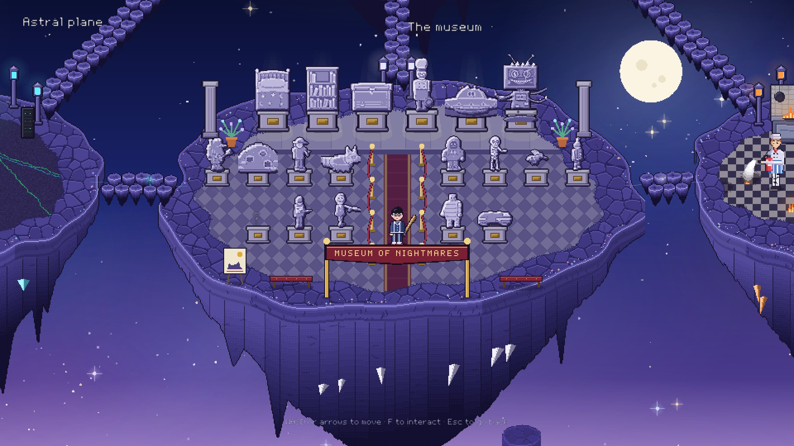

### Diario del sueño

Al despertar, ganes o pierdas, sale una hoja del diario de Kroker (papel de libreta con margen rojo y estrellitas a boli): cuántos sueños soñó, cuánto duró, a cuántos tumbó, tiró por agujeros y cuántos golpes recibió, **qué le despertó** (el enemigo o el ataque que le dio el último golpe, o el sangrado), las mejoras, dúos y combos que llevaba, y una frase del personaje que más le ayudó.

### Álbum de pegatinas

Cada combo que descubres, cada mejora dúo y cada mejora legendaria que consigues por primera vez se pega en el **álbum de pegatinas del diario**: el diario de fin de partida dice cuáles son nuevas, y el álbum está en un atril del **museo** del plano astral. Hay 29 pegatinas (11 combos con los colores de quienes lo forman, 9 dúos con las caras de la pareja y 9 leyendas, medallas doradas con la cara del personaje). Las que faltan salen en gris con una pista.

### Accesibilidad y consejos

En Ajustes → Accesibilidad: fuerza del temblor de pantalla, modo daltónico (avisos en amarillo y, además, un símbolo sobre cada élite: flechas para el que se divide, gota para el de los charcos y rayo para el rápido), números de daño, vibración, **reducir destellos** (los fogonazos de pantalla, los glitches del sueño 20 y los fundidos a blanco se suavizan), **texto grande** (un 25 % más, en las pantallas que se abran después) y **consejos la primera vez**: un cartelito corto la primera vez que pasa algo (si en partidas anteriores ya te había pasado, no sale) (al empezar, el primer trozo de estrella, el primer agujero, el primer élite, el primer sangrado, la primera Realidad Fragmentada y el primer jefe).

### Modo Dios (para probar)

Se activa con el botón **Modo Dios** de la ventana de la fuente del plano astral. Permite empezar en cualquier sueño (1–15), elegir una segunda arma y poner las mejoras de cada arma y las estadísticas que quieras. Desde el sueño 11, si no eliges segunda arma, se pone una de prueba. Las partidas en Modo Dios no se guardan. Si empiezas en el Acto 2, traes 30 ◆ para probar el kiosco.

Teclas durante la partida:

| Tecla | Efecto |
|---|---|
| **F** (Select en el mando) | Activa o desactiva la invulnerabilidad |
| **N** | Acaba el sueño, o el mueble, si estás en el jefe |
| **K** | Borra los enemigos |
| **L** | Sube de nivel |

### Demo

Hay tres exportaciones de demo (Windows, Linux y macOS) en `export_presets.cfg`. La demo se activa con la etiqueta de característica `demo` (o, para probarla en el editor, con *Ajustes del proyecto → dreamed/demo*). En la demo:

- no salen el Modo Dios ni los botones de desbloquear bestiario y personajes;
- **sí** está el botón «Desbloquear todo» del menú principal;
- el guardado va en archivos aparte (`*_demo.cfg`), para no mezclarse con el de las pruebas.

Para hacer una demo nueva basta con volver a exportar con esos presets.

---

## Estructura del proyecto

```
scenes/                 escenas principales (menú, partida, plano astral, ajustes)
scripts/autoload/       I18n (textos ES/EN), Settings, GameState (reglas), Progress (guardado y logros), Audio
scripts/data/           datos para equilibrar: run_data (oleadas, pijamas, subidas de nivel), upgrade_data (mejoras, dúos, combos), shop_data (kiosco, tratos de Magnus)
scripts/game/           la partida: run.gd (bucle de la partida) con run_bosses.gd (jefes), run_events.gd (sucesos, timbre, taquilla, edificios que caen) y run_cinematics.gd (llegadas y despertares); salas, Kroker, enemigos, armas, HUD, efectos
scripts/game/city/      piezas de la Metrópolis: edificios, carteles, decorados, ambiente y enjambre de anuncios
scripts/ui/             menús, logros, subida de nivel, plano astral, Charo y su kiosco, chimenea, tarjetas de palabras clave
scripts/ui/hub/         el hub: el mundo de islas, el retrato y el marco del diálogo
scripts/visual/         dibujo de los sprites (Sprites, SpriteRects), Kroker, personajes y PixelView
assets/sprites/         sprites en pixel art (generados)
assets/audio/           música (.ogg) y efectos (.wav) (generados)
assets/fonts/           Dreampix, la fuente propia (generada)
assets/shaders/         contorno de los élites y oscuridad del apagón
tools/                  generadores de sprites, sonido y fuente
docs/screenshots/       capturas de este README
```

**Para cambiar el equilibrio del juego**, casi todo está a la vista en un solo sitio:

- **Oleadas:** `RunData.WAVES` en `scripts/data/run_data.gd` (duración, enemigos, chimenea, kiosco). GameState las reexpone con el mismo nombre.
- **Estadísticas base:** `GameState.BASE_STATS` y `GameState.BASE_LEVEL_STATS`.
- **Mejoras por nivel:** `UpgradeData.UPGRADE_VALUES` en `scripts/data/upgrade_data.gd`.
- **Golpe fuerte y caídas en cadena:** `GameState.HEAVY_EVERY`, `HEAVY_KNOCK` y `FALL_CHAIN_*`.
- **Subidas de nivel y rarezas:** `GameState.STAT_STEPS` y `GameState.RARITY_WEIGHT`.
- **Kiosco y moneda:** `ShopData.WARES` (en `scripts/data/shop_data.gd`) (nivel y precio de cada artículo), `GameState.WARE_TIER_WEIGHT` y `GameState.REALITY_*`.
- **Dureza de los jefes:** `GameState.BOSS_POWER` (un solo multiplicador para todos).
- **Tratos de Magnus:** `ShopData.INVEST_SIZES` y `ShopData.INVEST_GOALS`.
- **Tope del parry:** `GameState.PARRY_MAX`.
- **Daño, alcance y recarga de cada arma:** las constantes al principio de `scripts/game/weapon_*.gd`.
- **Textos:** `scripts/autoload/i18n.gd`, con cada clave en `es` y `en`.

## Herramientas

- **tools/ui_icons.py** (lo llama make_sprites.py): iconos de interfaz en pixel art con el mismo sombreado duro del resto del juego. Estadísticas (`icon_<stat>`, cartas de subir de nivel y pausa), estados alterados (`status_<id>`), artículos del kiosco (`ware_<id>`), piezas pequeñas del mundo (altavoz de Lil Key, claqueta de los actores, teles del anuncio, símbolos de élite), armas en grande para la pantalla de la segunda arma (`wicon_<arma>`) y Kroker con el doble de resolución (`hk_*`, en el plano astral, para que tenga el mismo detalle que los personajes; la cara se pinta con píxeles de 2).

Todo el arte y el sonido se generan con los scripts de `tools/`:

| Script | Qué genera | Necesita |
|---|---|---|
| `make_sprites.py` | Dibuja cada pieza en SVG, la rasteriza con Chromium y la reduce a pixel art (paleta corta y contorno de 1 píxel). Crea `assets/sprites/*.png` y `scripts/visual/sprite_rects.gd` | Python 3, Pillow, Playwright con Chromium |
| `make_hub.py` | El terreno del plano astral píxel a píxel: islas de piedra astral con losas irregulares, canto, panza de roca con cristales y el suelo de cada personaje. Crea `assets/sprites/hub_isle_*.png` y `scripts/visual/hub_layout.gd` (posiciones y zonas por las que se anda). Los muebles del plano astral están en `hub_props.py` y los dibuja `make_sprites.py` | Python 3, numpy, Pillow |
| `make_audio.py` | Música y efectos con síntesis por modelado físico, siempre suaves | Python 3, numpy, scipy, ffmpeg (para .ogg) |
| `audio_themes.py` | Lo usa `make_audio.py`: instrumentos extra (piano eléctrico FM, onda cuadrada, acordeón, metales, silbido, glockenspiel, batería, 808...), el tema de cada personaje, sus leitmotivs y la versión mejorada de la música y los efectos principales | lo mismo |
| `make_font.py` | La fuente pixel art Dreampix en formato BMFont | Python 3, Pillow |

```bash
python3 tools/make_sprites.py                     # todos los sprites
python3 tools/make_sprites.py npc_charo nest_body # solo esos
python3 tools/make_sprites.py hub               # solo los muebles del plano astral
python3 tools/make_hub.py                         # islas del plano astral
python3 tools/make_audio.py fire reality          # solo esos sonidos
python3 tools/make_font.py
godot --headless --path . --import                # que Godot importe lo nuevo
```

En los `.wav` nuevos hay que poner `compress/mode=0` en su `.import`, y en los que hacen bucle, también `edit/loop_mode=2`. En los `.ogg` de música, `loop=true`.

### Música

Cada lugar y cada personaje tiene su tema (todos en bucle y suaves):

| Tema | Dónde suena | Cómo suena |
|---|---|---|
| Menú | Menú principal | Nana de arpa y kalimba, con una segunda parte con cuerdas y caja de música |
| Cuarto | Acto 1 | Lenta y un poco rara, marimba, arpa, caja de música y escobillas |
| Salón | Acto 2 | Vals de caja de música con el tic-tac del reloj |
| Colegio | Acto 3 | Xilófono, flauta dulce de clase de música, palmas y el timbre... con acordes que se tuercen |
| Metrópolis | Acto 4 | Paseo alegre por la ciudad con bajo que camina, batería suave y metales |
| Noir / Evil Ad | Sueño 20 | Jazz de madrugada / jingle de anuncio retorcido |
| Jefes | Muebles, El Chef, El Ovni | Tambor de fieltro y metales que avisan / cocina con prisa / ciencia ficción de los 50 con theremin |
| Plano astral | Cruce de los sueños, museo, vestidor | Acordes que flotan, kalimba lejana y coro muy suave |
| **Svinho** | Su isla | Bossa nova con guitarra de nailon, surdo, silbido; en la segunda vuelta, murmullo de estadio y el silbato del árbitro |
| **Stolk** | Su isla | Medio tiempo pesado y chulesco, bajo saturado, metales a golpes y el clonc de una pesa |
| **Silly** | Su isla | Chiptune de hacker: arpegios de 8 bits, su teclado hace de charles y glitches al final de las frases |
| **Doc** | Su isla | Consulta tranquila: piano eléctrico, un latido de bombo, el pitido del monitor afinado y caja de música |
| **Mr. Ad** | Su isla | Jingle de anuncio de juguetes con ukelele y glockenspiel... con notas que se desafinan y la tele que chisporrotea |
| **Pinche** | Su isla | Tarantela de cocina con acordeón, pandereta, cazos, cuchillo picando y la sartén chisporroteando |
| **Charo** | Su isla | Vals de abuela con acordeón, guitarra, caja de música y las agujas de punto |
| **Magnus** | Su isla | Jazz de despacho con swing, trompeta con sordina y caja registradora |
| **SuperK** | Su isla | Fanfarria de héroe: cuerdas, timbales, redobles y metales que suben |
| **Lil Key** | Su isla | Dembow con 808, sinte con eco y un «¡eh!» de coro |
| **D. Lynx** | Su isla | Jazz lento y raro en Re menor: pad oscuro, contrabajo, escobillas, vibráfono con trémolo y guitarra eléctrica con eco |

En el plano astral, la música cambia con un fundido al entrar en la isla de cada personaje. Lo que suena al hablar con ellos es el arranque de su tema (su leitmotiv); también suena, claro y con la música bajada un momento, al elegir su mejora tras cada sueño, y el de Charo cuando te da la bienvenida la primera vez y cada vez que abre el kiosco. SuperK, Lil Key y D. Lynx también hacen sonar el suyo cada vez que aparecen en un sueño a ayudarte (con la música bajada solo un poco). Los sonidos de los botones son toques de kalimba graves, cortos y apagados.

### Bot de equilibrio

`tools/balance_bot.gd` juega partidas enteras con cada pijama, acelerado y sin ventana, y guarda un informe con cómo acaba cada sueño: vida, nivel, Realidad Fragmentada y dónde muere. No es un jugador experto, así que sirve para **comparar** pijamas y cambios, no para medir la dificultad exacta.

1. Añade `B="*res://tools/balance_bot.gd"` en `[autoload]` de `project.godot` (sin subirlo).
2. Ejecuta:

```bash
godot --headless --path . --audio-driver Dummy -- --bot-runs=2   # 2 partidas por pijama
```

El informe queda en `user://balance_report.json`. Otras opciones: `--bot-weapons=bat,book` (qué pijamas), `--bot-diff=nightmare`, `--bot-speed=12` (aceleración), `--bot-immortal` (no muere: cuenta las muertes y sigue hasta el Sueño 20, para medir los 20 sueños enteros) y `--bot-unlocked` (todo desbloqueado). Para lanzar dos a la vez sin pisarse el guardado, usa un `XDG_DATA_HOME` distinto en cada uno.

### Exportar

`export_presets.cfg` trae las demos (Windows, Linux y macOS) y el juego completo para Windows (`Dreamed (Windows)`, en `build/full/Dreamed.exe`), con el icono de Mr. Ad, la versión y el nombre en las propiedades del ejecutable. En Windows el guardado está en `%APPDATA%\Godot\app_userdata\Dreamed`.

---

## English summary

**Dreamed** is a Brotato-style survival roguelite with Hades-style upgrades, made in Godot 4.7 (tested on 4.7.2), fully playable in **English and Spanish**.

- **Kroker:** a boy with glasses who falls asleep. Every wave is a dream inside the previous one, each stranger than the last.
- **Eight pajamas, eight auto-attacking weapons:** bat, pillow shield, storybook (lightning from the sky) and vacuum from the start; a finger gun (Act 2) and a teddy bear (Act 3) unlocked by playing; a bouncing football (friendship 4 with Svinho) and a laptop that places permanent turrets which level up with your attack (friendship 4 with Silly). The character select shows them in pages of four, each card with a full stat sheet.
- **Act 1, the bedroom:** Foox, thugs, slingshots and skeletons, then the living furniture: a bed, a bookshelf and a toy chest that runs away and gets tired.
- **Act 2, the living room:** mosquito nests, hacking Cyberpunks, a fireplace where you can sacrifice upgrades, *Karen the kiosk lady*, who trades in **Fragmented Reality**, and **The Chef**, a grown-up Kroker who climbs out of the TV.
- **Act 3, the endless school hallway at dusk:** puppets with random weapons, toilet-paper golems whose stench disables one of your weapons, a school-bell event, and **the UFO**, which wrecks the hallway, crashes down on you and fires rings of lasers.
- **Second weapon:** after The Chef you pick a second weapon of the other kind (melee or ranged), with its own upgrades.
- **Upgrades:** on the astral plane, Svinho, Stolk, Silly, Doc, Mr. Ad, the Kitchen Boy and **Magnus** (a magnate who lets you invest: pay for several stat boosts and keep them, with interest, if you meet his goal) each offer a different kind of upgrade. Star shards level Kroker up with stat boosts from common to legendary, including **parry**: a chance to dodge a hit and finger-snap the attacker and nearby enemies away.
- **Karen's kiosk** sells better and pricier items each act; friendship with her gives free restocks, half-price offers and more slots.
- **Fever and daily dream:** optional pacts (more enemies, faster or harder-hitting enemies, less health, no kiosk, one weapon...) raise Kroker's temperature and the star-shard reward; a daily dream with a date-based pajama, pacts and seed.
- **Feel:** throwing an enemy down a hole freezes the game for an instant, shakes the screen and plays a falling kalimba glissando; big enemies get a hit stop too, and most enemies have their own death sound. A "Yawns" dream event opens short-lived holes next to enemies.
- **Credits:** from the main menu, and on their own the first time you wake from dream 20, listing the cast you have met and the nightmares you have seen.
- **Extras:** Nightmare difficulty, a bestiary, 35 achievements, hover cards that explain keywords and status effects, accessibility options, full gamepad support (the UI adapts to keyboard or gamepad), a God mode for testing and demo builds for Windows, Linux and macOS.
- **Running it:** open `project.godot` and press **F5**. All sprites, sounds and the font are generated by the scripts in `tools/`.
