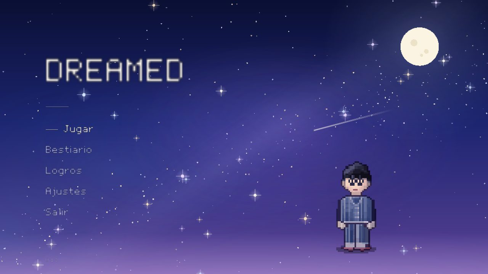
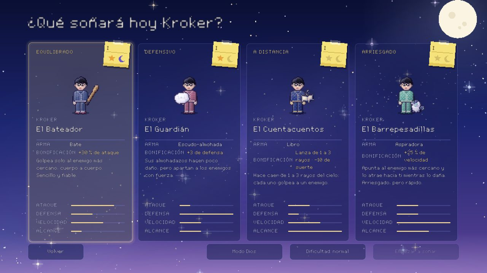
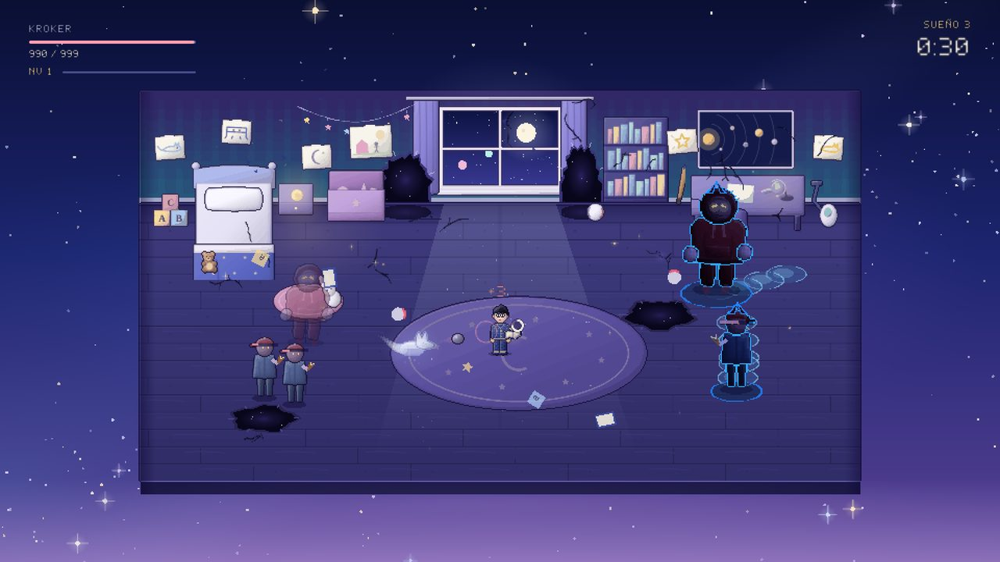
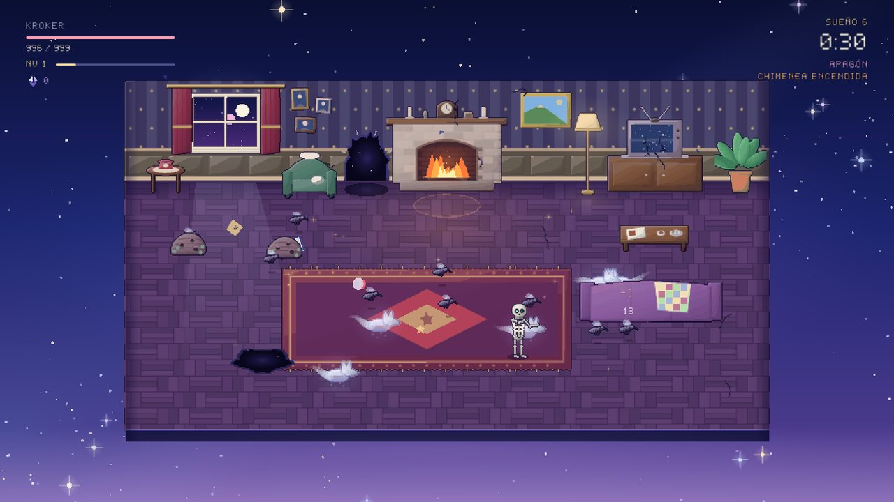
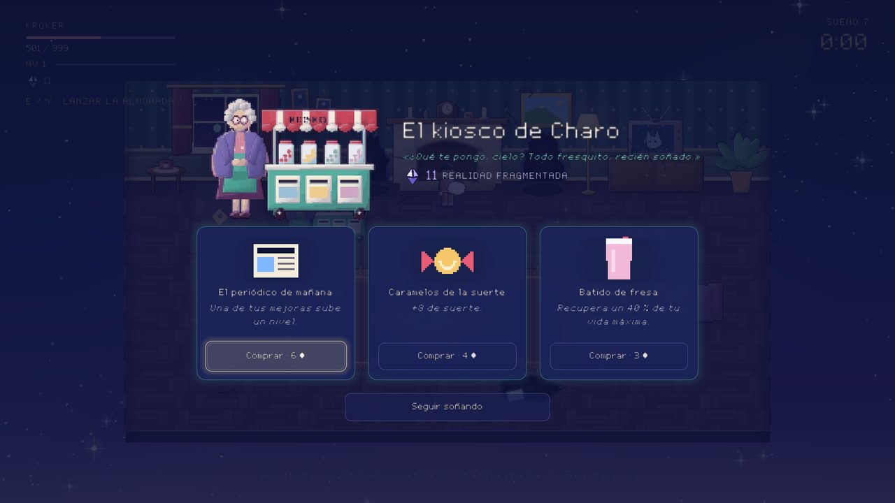
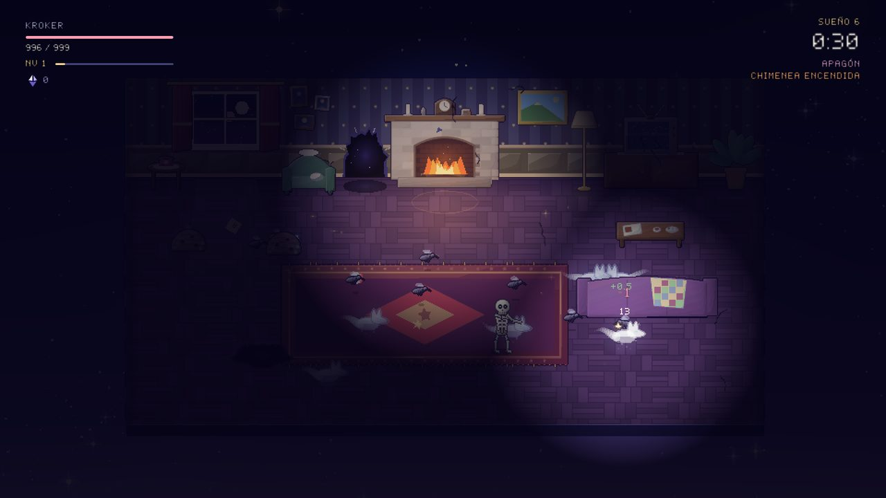
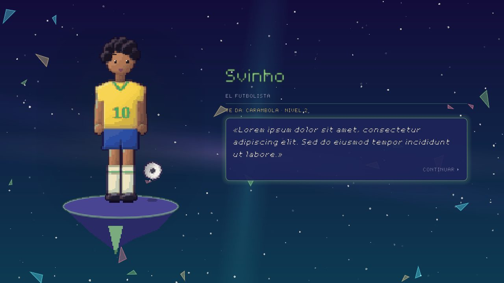
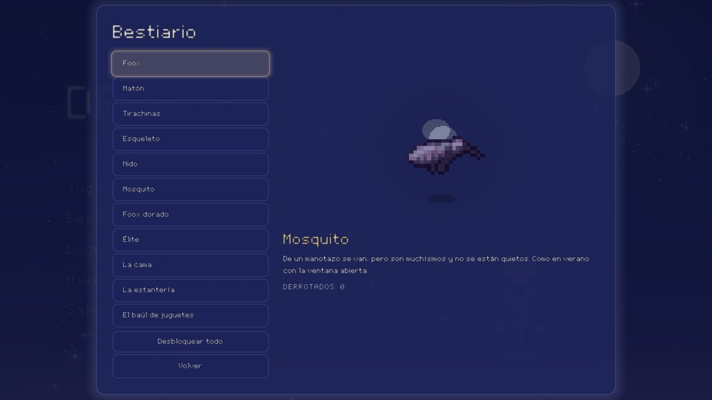

# Dreamed

*Un roguelite de supervivencia en pixel art sobre un niño que sueña dentro de un sueño dentro de un sueño.*
*A pixel-art survival roguelite about a boy dreaming inside a dream inside a dream.* — [English summary below](#english-summary)



Kroker es un niño con gafas y pelo negro que se queda dormido... y cada oleada es un sueño dentro del anterior, cada vez más raro y abstracto. Se juega como **Brotato**: el arma ataca sola y tú solo te mueves y esquivas. Entre sueño y sueño mejoras al estilo de **Hades**: en el plano astral aparecen dos personajes y cada uno te ofrece un don distinto.

- **Motor:** Godot 4.7, probado en **Godot 4.7.2**.
- **Idiomas:** español e inglés, que se cambian en Ajustes.
- **Controles:** teclado, ratón y mando.
- **Arte y sonido:** todo hecho con código, desde los sprites y la fuente hasta la música y los efectos (ver [Herramientas](#herramientas)).

---

## Cómo jugar

1. Abre `project.godot` con Godot 4.7.2 y pulsa **F5**.
2. En el menú principal, pulsa **Jugar** y elige un pijama: cada uno trae un arma distinta.
3. Sobrevive a cada sueño hasta que se acabe el tiempo. Tu arma ataca sola.
4. Recoge los **trozos de estrella** que sueltan los enemigos para subir de nivel.
5. Al acabar cada sueño, en el **plano astral**, elige uno de los dos dones que te ofrecen.
6. La partida se guarda al empezar cada sueño. Si sales, **Continuar** en el menú principal te devuelve al principio de ese sueño.

### Controles

| Acción | Teclado | Mando |
|---|---|---|
| Moverse | WASD o flechas | Stick izquierdo o cruceta |
| Modo especial (almohada de Svinho) | E | Y |
| Avanzar diálogos | Intro, Espacio o clic | A |
| Pausa (con resumen de estadísticas y mejoras) | Esc | Start |

El mando vibra al recibir golpes; se puede desactivar en *Ajustes → Accesibilidad*.

---

## Los cuatro pijamas

Siempre es Kroker, pero vestido distinto, y cada pijama trae su arma.



| Pijama | Arma | Cómo ataca | Bonificación de serie |
|---|---|---|---|
| **El Bateador** | Bate | Golpe cuerpo a cuerpo al enemigo más cercano | +30 % de ataque y 3 de regeneración |
| **El Guardián** | Escudo-almohada | Poco daño, pero empuja mucho en cono | +3 de defensa y 3 de regeneración |
| **El Cuentacuentos** | Libro | Hace caer de 1 a 3 rayos del cielo; cada uno golpea a un enemigo | −10 de suerte y 5 % de robo de salud |
| **El Barrepesadillas** | Aspiradora | Atrae al enemigo al que apunta mientras lo daña | +25 % de velocidad y 5 % de robo de salud |

Cada pijama tiene un **post-it** con los actos que has superado con él (Acto I y Acto II; estrella en normal, luna en pesadilla), al estilo de *The Binding of Isaac*. Todo lo que tiene tiempo de recarga muestra un anillo de carga en la propia arma, como la stamina de *Zelda*.

---

## Los sueños

### Acto 1: la habitación (sueños 1–5)



Kroker se despierta, se pone las gafas y coge su arma. En cada sueño la habitación se corrompe un poco más: salen grietas, trozos de pared flotando y **agujeros** en el suelo y en la pared. Si empujas un enemigo a un agujero, cae y muere aunque le quede vida.

| Sueño | Enemigo nuevo |
|---|---|
| 1 | **Foox**: zorro fantasma, lento y frágil |
| 2 | **Matón**: enorme, mucha vida y golpes fuertes |
| 3 | **Tirachinas**: marca la trayectoria antes de disparar |
| 4 | **Esqueleto**: se desmonta y, si no rompes sus huesos, se vuelve a levantar |
| 5 | **Jefe: la habitación despierta**. Primero la cama, que salta y provoca un sismo; luego la estantería, que lanza libros; y por último el baúl, que huye y suelta enemigos |

### Acto 2: el salón (sueños 6–10)



Tras vencer al jefe, el sueño se hunde un poco más y Kroker cae en el salón de casa: chimenea de piedra, sillón de la abuela, una tele antigua con nieve y un sofá que tapa a quien pasa por detrás.

| Sueño | Novedad |
|---|---|
| 6 | **Nidos y mosquitos**: el nido no se mueve, pero suelta mosquitos mientras no lo rompas. Los mosquitos son diminutos y frágiles, pero muy rápidos y salen a montones |
| 8 | **Cyberpunk** (raro, como mucho 2 a la vez): se lanza a base de dashes que marca antes en el suelo y, si se te queda cerca, te **hackea**: te baja una estadística al azar hasta que lo derrotas |
| 10 | **Jefe: El Chef**, un Kroker adulto cocinero que sale de la tele |

**El Chef** tiene tres ataques, todos avisados antes:

- **Cuchillos** en abanico: si te da uno, sangras durante un rato.
- **Sartenazo** de cerca: si te da, te quedas clavado medio segundo.
- **Platos** lanzados en arco a puntos marcados: al romperse dejan trozos en el suelo que hacen daño al pisarlos.

Con menos de la mitad de vida se enfada: ataca más a menudo y lanza más cosas.

El resto del salón:

- **Kioskera Charo** (*Karen* en inglés): la primera vez que llegas, te da la bienvenida y te explica dónde estás. De vez en cuando abre su kiosco para venderte cosas a cambio de **Realidad Fragmentada**. Una vez la conoces, también aparece tras el sueño 3 del Acto 1.
- **Realidad Fragmentada:** la moneda de Charo. Sale de lo que más guerra da y de lo que se cae y no vuelve... Una vez conoces a Charo, también se gana en el Acto 1 de las partidas siguientes.
- **La chimenea:** en algunos sueños está encendida. Quédate delante y podrás echar una de tus mejoras al fuego: pierde un nivel, pero ganas Realidad Fragmentada.



### Segunda arma y Acto 3 (provisional, sueños 11–13)

Al vencer a El Chef eliges una **segunda arma**, siempre del otro tipo: si tu pijama lleva un arma cuerpo a cuerpo (bate o almohada), eliges una a distancia (libro o aspiradora), y al revés. La segunda arma flota junto a Kroker, ataca sola y tiene **sus propias mejoras**. En el plano astral, cada don tiene una pestaña por arma para decidir a cuál va.

El Acto 3 es por ahora un escenario **en obras**, pensado para probar las dos armas. La partida termina al acabar el sueño 13.

### Jefes con tiempo límite

Los jefes tienen cuenta atrás: 2:30 los muebles del Acto 1 y 2:00 El Chef. Si aguantas hasta el final, el jefe se retira y pasas igualmente. Si lo derrotas antes, te llevas **un nivel de regalo**.

### Eventos

Desde el sueño 2, algunos sueños traen un evento al azar:

- **Apagón:** solo ves alrededor de Kroker y, si la chimenea está encendida, alrededor del fuego.
- **Suelo inclinado:** todo resbala hacia un lado y luego hacia otro.
- **Foox dorado:** no hace daño y huye. Si lo pillas antes de que se esfume, te llueven estrellas.



### Élites

Son enemigos demoníacos, con cuernos, más grandes y con el triple de vida. El color del contorno dice qué hacen:

- **Naranja:** al morir se parten en dos Foox.
- **Azul:** dejan charcos que te frenan.
- **Morado:** van mucho más rápido.

---

## Cómo mejora Kroker

### Plano astral

Entre un sueño y otro aparecen dos de estos personajes. Cada uno da un tipo de mejora que cambia según tu arma y que sube hasta el nivel 3. Al elegir, te quedas a solas con él y te habla.

| Personaje | Quién es | Tipo de mejora |
|---|---|---|
| **Svinho** | Futbolista brasileño | Rebotes: golpes que encadenan enemigos y una almohada que se lanza |
| **Stolk** | El matón del colegio | Mucho más poder a cambio de vida máxima |
| **Silly** | Una hacker | Glitches: congelar, ralentizar o dejar vulnerables a los enemigos |
| **Doc** | Un doctor | Más vida máxima a cambio de empeorar otra estadística |
| **Mr. Ad** | Un humanoide cubierto de anuncios de chocolatinas y comida basura | Más Realidad Fragmentada y una estadística que sube cuanta más tengas ahorrada. Se desbloquea al llegar por primera vez al Acto 2 (con un logro) y desde entonces puede salir desde el principio |



### Niveles

Los enemigos sueltan **trozos de estrella**; cuanto más duro es el enemigo, más sueltan. Al subir de nivel eliges 1 de 3 mejoras de estadística, cada una con su rareza: común, poco común, rara, épica o legendaria.

Las estadísticas son ataque, defensa, velocidad, velocidad de ataque, alcance, recuperación de salud, robo de salud y suerte. La **suerte** hace más probables las rarezas altas, los consumibles y que vuelvan los personajes que ya te dieron un don. Puedes cambiar las tres opciones a cambio de 2 de suerte.

### Consumibles

A veces un enemigo suelta un objeto, y la suerte hace que pase más a menudo:

- **Vaso de leche:** cura.
- **Almohada:** para el siguiente golpe.
- **Despertador:** congela a todos los enemigos.

### La vida

La vida no se rellena entre sueños: solo recuperas un 5 % de la vida máxima.

---

## Más

- **Dificultad Pesadilla:** se desbloquea al superar el Acto 1. Los enemigos tienen más vida y más daño, y salen más élites. En el jefe, los tres muebles atacan a la vez, aunque más despacio.
- **Personajes:** menú con Kroker y sus pijamas, los personajes del plano astral, Mr. Ad y Charo. Cada uno se desbloquea al conocerlo.
- **Bestiario:** está en el menú principal y cada entrada está escrita con la voz de Kroker.
- **Logros:** hay 18 (entre ellos, vencer a El Chef, comprar en el kiosco, sacrificar en la chimenea y ahorrar 100 de Realidad Fragmentada). Algunos pegan un dibujo infantil nuevo en la pared de la habitación.
- **Accesibilidad:**
  - intensidad de la sacudida de pantalla;
  - avisos para daltónicos;
  - números de daño;
  - vibración.
- **Al morir**, Kroker se despierta de golpe en su cama. **Al ganar**, duerme tranquilo y ves el resumen de la partida.



### Modo Dios (para probar)

Se activa con el botón **Modo Dios** de la selección de personaje. Permite empezar en cualquier sueño (1–13), elegir una segunda arma y poner las mejoras de cada arma y las estadísticas que quieras. Desde el sueño 11, si no eliges segunda arma, se pone una de prueba. Las partidas en Modo Dios no se guardan. Si empiezas en el Acto 2, traes 30 ◆ para probar el kiosco.

Teclas durante la partida:

| Tecla | Efecto |
|---|---|
| **F** (Select en el mando) | Activa o desactiva la invulnerabilidad |
| **N** | Acaba el sueño, o el mueble, si estás en el jefe |
| **K** | Borra los enemigos |
| **L** | Sube de nivel |

---

## Estructura del proyecto

```
scenes/                 escenas principales (menú, selección, partida, plano astral, ajustes)
scripts/autoload/       I18n (textos ES/EN), Settings, GameState (datos y reglas), Progress (guardado y logros), Audio
scripts/game/           la partida: run.gd, bedroom.gd, living_room.gd, Kroker, enemigos, armas, jefe, HUD, efectos
scripts/ui/             menús, bestiario, logros, subida de nivel, plano astral, Charo y su kiosco, chimenea
scripts/visual/         dibujo de los sprites (Sprites, SpriteRects), Kroker, personajes y PixelView
assets/sprites/         sprites en pixel art (generados)
assets/audio/           música (.ogg) y efectos (.wav) (generados)
assets/fonts/           Dreampix, la fuente propia (generada)
assets/shaders/         contorno de los élites y oscuridad del apagón
tools/                  generadores de sprites, sonido y fuente
docs/screenshots/       capturas de este README
```

**Para cambiar el equilibrio del juego**, casi todo está a la vista en un solo sitio:

- **Oleadas:** `GameState.WAVES` (duración, enemigos, chimenea, kiosco).
- **Estadísticas base:** `GameState.BASE_STATS` y `GameState.BASE_LEVEL_STATS`.
- **Mejoras por nivel:** `GameState.UPGRADE_VALUES`.
- **Subidas de nivel y rarezas:** `GameState.STAT_STEPS` y `GameState.RARITY_WEIGHT`.
- **Kiosco y moneda:** `GameState.WARES` y `GameState.REALITY_*`.
- **Daño, alcance y recarga de cada arma:** las constantes al principio de `scripts/game/weapon_*.gd`.
- **Textos:** `scripts/autoload/i18n.gd`, con cada clave en `es` y `en`.

## Herramientas

Todo el arte y el sonido se generan con los scripts de `tools/`:

| Script | Qué genera | Necesita |
|---|---|---|
| `make_sprites.py` | Dibuja cada pieza en SVG, la rasteriza con Chromium y la reduce a pixel art (paleta corta y contorno de 1 píxel). Crea `assets/sprites/*.png` y `scripts/visual/sprite_rects.gd` | Python 3, Pillow, Playwright con Chromium |
| `make_audio.py` | Música y efectos con síntesis por modelado físico, siempre suaves | Python 3, numpy, scipy, ffmpeg (para .ogg) |
| `make_font.py` | La fuente pixel art Dreampix en formato BMFont | Python 3, Pillow |

```bash
python3 tools/make_sprites.py                     # todos los sprites
python3 tools/make_sprites.py npc_charo nest_body # solo esos
python3 tools/make_audio.py fire reality          # solo esos sonidos
python3 tools/make_font.py
godot --headless --path . --import                # que Godot importe lo nuevo
```

En los `.wav` nuevos hay que poner `compress/mode=0` en su `.import`, y en los que hacen bucle, también `edit/loop_mode=2`.

### Bot de equilibrio

`tools/balance_bot.gd` juega partidas enteras con cada pijama, acelerado y sin ventana, y guarda un informe con cómo acaba cada sueño: vida, nivel, Realidad Fragmentada y dónde muere. No es un jugador experto, así que sirve para **comparar** pijamas y cambios, no para medir la dificultad exacta.

1. Añade `B="*res://tools/balance_bot.gd"` en `[autoload]` de `project.godot` (sin subirlo).
2. Ejecuta:

```bash
godot --headless --path . --audio-driver Dummy -- --bot-runs=2   # 2 partidas por pijama
```

El informe queda en `user://balance_report.json`.

---

## English summary

**Dreamed** is a Brotato-style survival roguelite with Hades-style upgrades, made in Godot 4.7 (tested on 4.7.2), fully playable in **English and Spanish**.

- **Kroker:** a boy with glasses who falls asleep. Every wave is a dream inside the previous one, each stranger than the last.
- **Weapons:** pick one of four pajamas, each with its own auto-attacking weapon: bat, pillow shield, storybook (lightning from the sky) or vacuum.
- **Act 1, the bedroom:** Foox, thugs, slingshots and skeletons, then a living-furniture boss.
- **Act 2, the living room:** mosquito nests, hacking Cyberpunks, a fireplace where you can sacrifice upgrades, *Karen the kiosk lady*, who trades in **Fragmented Reality**, and **The Chef**: a grown-up Kroker who climbs out of the TV throwing knives (bleeding), plates (shards on the floor) and swinging a frying pan (it roots you).
- **Second weapon:** after The Chef you pick a second weapon of the other kind (melee or ranged). It floats beside Kroker and has its own upgrades; Act 3 is a placeholder stage to try it out.
- **Upgrades:** between dreams, on the astral plane, Svinho, Stolk, Silly, Doc and Mr. Ad (unlocked in Act 2, all about Fragmented Reality) each offer a different kind of upgrade. Star shards level Kroker up with stat boosts from common to legendary.
- **Extras:** Nightmare difficulty, a bestiary, 12 achievements, accessibility options, full gamepad support and a God mode for testing.
- **Running it:** open `project.godot` and press **F5**. All sprites, sounds and the font are generated by the scripts in `tools/`.
